# Guided UI review - edited transcript

Source: `Screen Recording 2026-10-25 221608.mp4`  
Recording duration: **37:15.433**  
Format: one-speaker, lightly edited monologue.

> Editorial note: Lightly edited from the supplied transcript, not rewritten as a specification. Filler, repetition, and obvious recognition errors are corrected; opinions and tentative choices remain. Speech timecodes are approximate. Captions are editorial and give exact offsets for real, uncropped video frames. The recording starts mid-sentence.

## 00:00 - The reference and the next specifications

...application that I want to cover. This is something I want to take inspiration from for implementing the next set of specifications. Really understand the style, level of detail, and quality of the specifications you have already received.

I want you to break these specifications down into separate subsections, consistently understand our project's specification style, and help me create a new one. This will be about a major change to what we are developing.

This is another project; you can see its URL on the screen. You can access it, and it will also be available to the agent. I will give the link. I think the link is already in `AGENTS.md`; the agent just did not look into that reference.

This application is for designing prompts. It is not complete, but it is implemented in a better way, and I want to take a lot of inspiration from it.

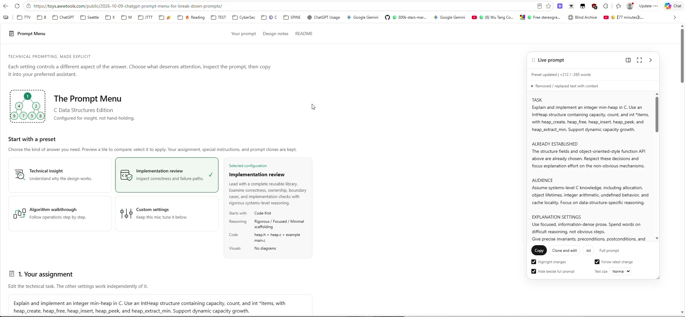

*Frame 01 - 00:00. The reference is The Prompt Menu, C Data Structures Edition. The visible address is https://toys.awwtools.com/public/2026-10-09-chatgpt-prompt-menu-for-break-down-prompts/.*

## 01:51 - Take the interaction patterns, not just the appearance

It serves a different purpose, but I think we are doing much the same thing. We should take huge inspiration from this and copy those interaction elements.

I want to explain my opinion in detail, point by point. Give me your opinion and recommendations: what do you think?

First, let's see how this application works and compare it with our current implementation.

## 02:36 - A draggable, resizable preview that can dock

In this other project, we have an advanced sidebar, which is not really a sidebar. You can see a "Live prompt" window, and it has some areas we can prefill.

We can drag this window, and it is resizable. There is a special dock icon that can turn it into a sidebar, so it will be on the side if needed. I can preview the prompt there.

This is only a preview panel. The key idea is that I do not have to keep it on the side if I do not want it there.

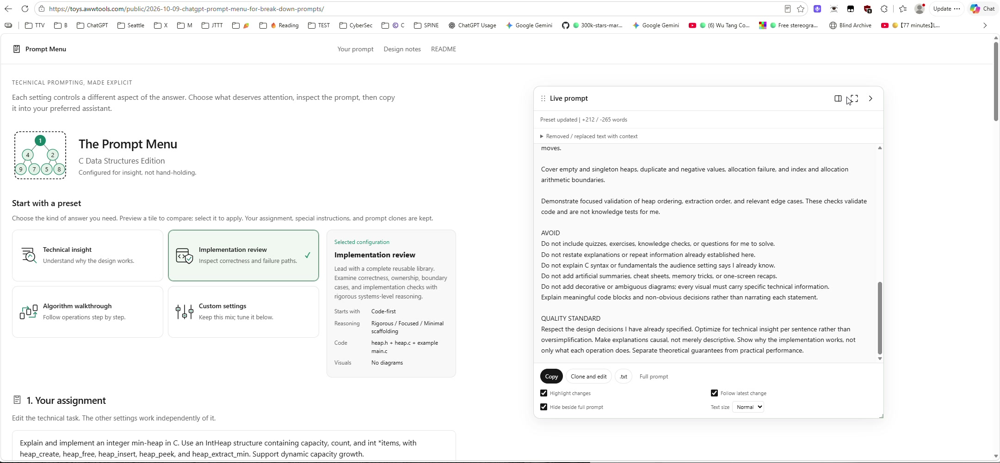

*Frame 02 - 03:05. The Live prompt window is floating and has been made substantially wider.*

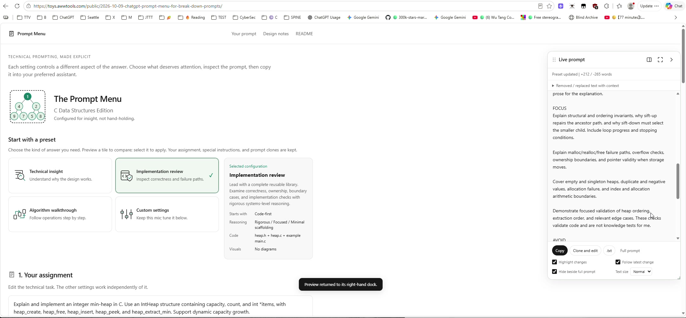

*Frame 03 - 03:10. The preview is back at the right edge. A visible notification says, "Preview returned to its right-hand dock."*

## 03:39 - Why editing values at the side is inconvenient

Now take a direct look at our application. Our sidebar is static. It takes space, and editing text requires you to move the mouse over to the side and edit it there.

We are asking the user to turn their head, maybe, and putting them in an inconvenient position. They are used to editing text in the center, but now they are restricted to editing values on the side.

Editing values on the side is inconvenient most of the time. We want our application to be customizable, so instead of forcing the user to do that, we should provide a floating window.

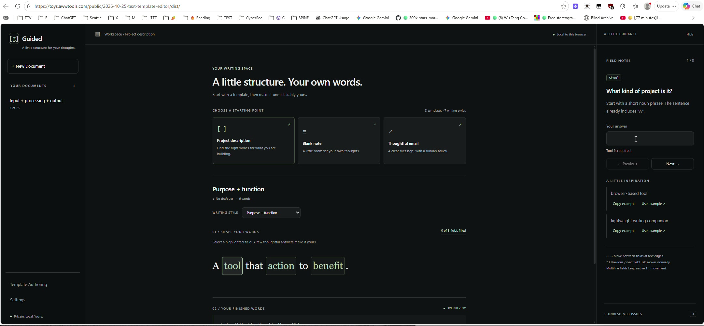

*Frame 04 - 03:58. The current Guided layout: document history on the left, the template in the center, and the fixed value editor on the right.*

## 04:39 - Separate value editing and errors into movable windows

We should be able to put this floating window into a "Dock to right" state, so it becomes a right sidebar. We should also be able to collapse it.

Maybe this will be a window for setting variables, and maybe it will also contain a preview of the prompt we are editing. It should have controls that make editing easier.

This reference does not have the value editing we need, so we should add that and create a better UI, following this example.

In the specification, describe the intent and mention that this specific project is listed in the references in `AGENTS.md`. It is there for the agent to inspect.

Describe in detail that we want docking to the right and collapsing when needed. This sidebar should be separate from errors. Errors can have their own floating window, which we can position somewhere else.

Imagine two floating windows. Both are resizable, and both can become docked sidebars. That is the main point: the user has controls and can keep what they need visible on screen.

## 06:59 - Text size and settings directly in the panel

The reference also has controls for quickly changing appearance. For instance, we can select normal or large text.

If I have trouble seeing the text, I can select large text and it becomes larger. We should not forget people with visual difficulties.

These are settings, but I can change them right here on the page. I do not have to go to a Settings page. That is more convenient, especially when the setting is specifically for the preview window.

This is another issue with our preview: the text is too tiny. I cannot resize this thing, so we keep the text tiny. That is bad.

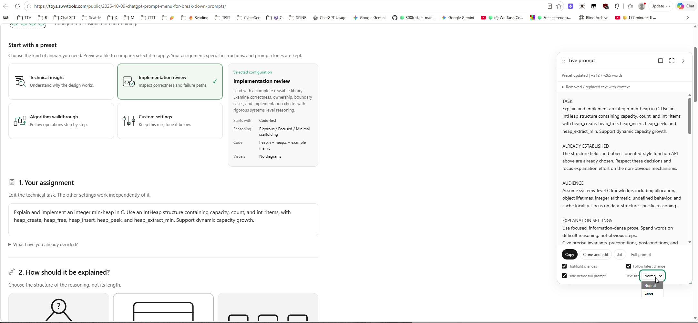

*Frame 05 - 07:05. The preview has its own Text size menu, with Normal and Large options.*

## 07:59 - Remember the user's layout

First of all, we need to save these layout changes. When we drag or resize a window, we need to remember its position.

Initially, I am thinking of IndexedDB: perhaps special tables to remember the positions of elements and the layout. We want users to reopen the application and get the same layout.

But I am not saying it has to be IndexedDB. It could be localStorage, too. For UI layout, localStorage may be the better, preferred option.

You know what? LocalStorage is better.

## 09:19 - Multiple tabs and when to write layout changes

What if several tabs are open and the user positions these windows differently? For localStorage, the last write wins.

We read the layout positions from localStorage on page load. Then, when the user changes something, we save that change. Only when there is an actual change do we write it back.

## 10:07 - Validate restored positions so windows cannot disappear

When we load the configuration, make sure there is a sanity check.

We may not be able to load a valid layout because the browser size has changed. Detect incorrect layout values on load and fill those values with defaults until we have a correct, valid state.

We do not want a window to disappear. If I resize the browser, the window may end up somewhere off to the right, where it is invisible.

If the X position is wrong, for instance, it is better to use a default as a fallback.

## 11:19 - The value editor, template search, and ranking

I want the value editor in our current Guided application to be a floating window and to take as much as possible from this example.

Some things have already been taken from the reference, but not everything.

For instance, the prompt selection - what we call a version in our terminology - shows a name, such as "Technical insight."

For our application, we should also implement search: full-text search with ranking. Search the title and the content inside the template. A fuzzy search, like Visual Studio Code.

People should search for something and find the most relevant results. We do not have a lot of templates, and we are only searching templates.

## 12:39 - Helpful contextual explanations

Here we also have help. When I hover over different elements, it shows a help message, and that help is useful. We need to include that, too.

For example, "Custom settings" can show a help preview. At least we can provide that kind of preview help.

## 13:19 - A flexible left sidebar and less wasted space

Another thing is wasted space. In Guided, we have what looks like a chat list.

I think that can also be a floating window or sidebar, but on the left. The same idea: it can become a sidebar if needed, and it can collapse and expand.

We do not want to waste a lot of space on the sides just to make it look pretty. I would rather have this kind of design and controls to increase the font, perhaps by selecting from a few predefined sizes.

## 14:00 - Remove the marketing copy

We also need to remove all this unnecessary text that AI usually adds.

Under "Guided," we have "A little structure for your thoughts." It is very small, and it needs to be removed. We do not need that. I did not ask for it.

"Your documents" is fine. "Template Authoring" is fine. But then we have a green dot and "Private. Local. Yours." I did not ask for this marketing crap. Remove it.

"Local to this browser" is also a bad description. There is another dot that is supposed to mean something, but it means nothing. Remove that, too.

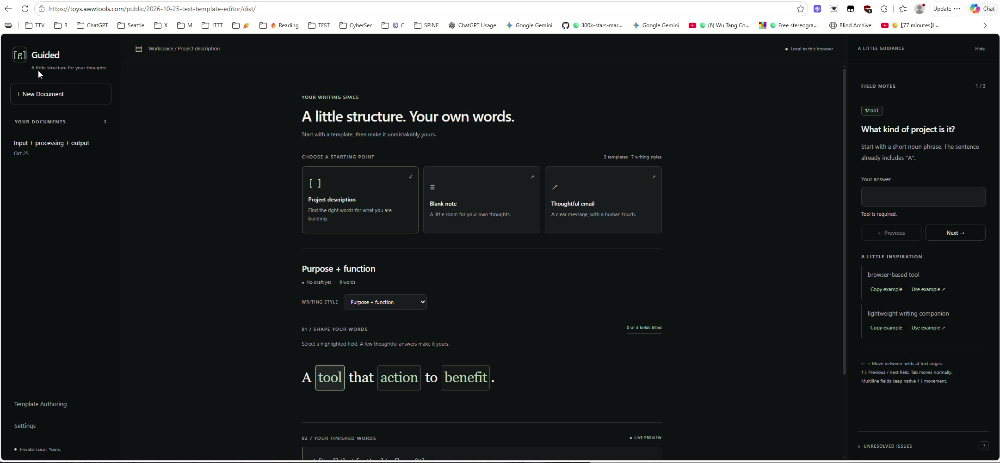

*Frame 06 - 14:15. The existing tagline, footer slogan, status dots, and "Local to this browser" label are visible; these are the elements being criticized.*

## 15:09 - Hiding a panel must actually recover its space

"A little guidance" is a horrible name. Rename it.

And what happens when I click "Hide"? What are we hiding? We have just made a blank space. This sidebar is not resizable, either.

We hide it, and it just clears the text. It did not hide the sidebar; it left the space there. That is a problem.

The templates are kind of working, but this interaction is not useful.

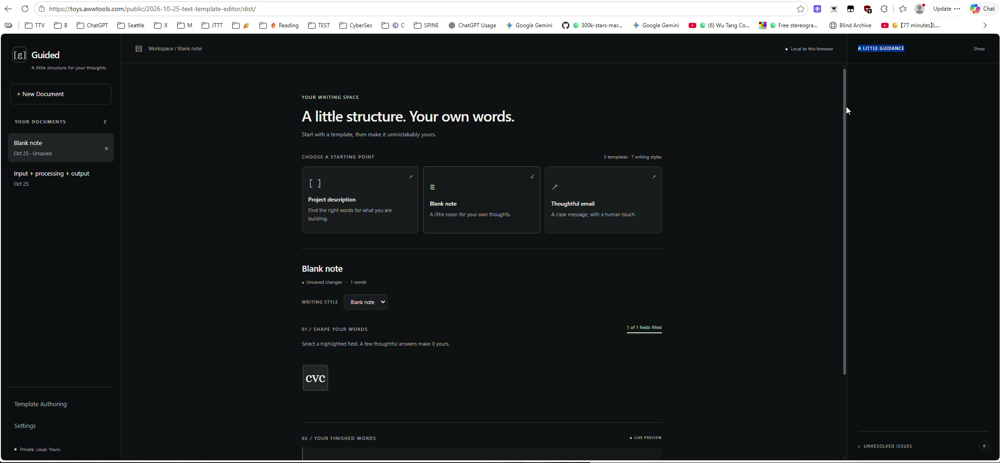

*Frame 07 - 15:24. "Show" is visible at the top of the right region, but the empty column still occupies its width.*

## 15:59 - New Document and more pragmatic wording

Then we have "Your writing space," followed by "A little structure. Your own words."

Does this appear all the time?

Oh, I cannot create a new document. "Tool needs a valid answer." Okay... I did create one.

So New Document is "A little structure. Your own words." Then, "Start with a template, then make it unmistakably yours." This is marketing bullshit. I do not want it.

We have "Choose a starting point." We need to reword this. Remove "Your writing space," "A little structure. Your own words," and "Start with a template, then make it unmistakably yours."

I want to review everything and make the wording more pragmatic.

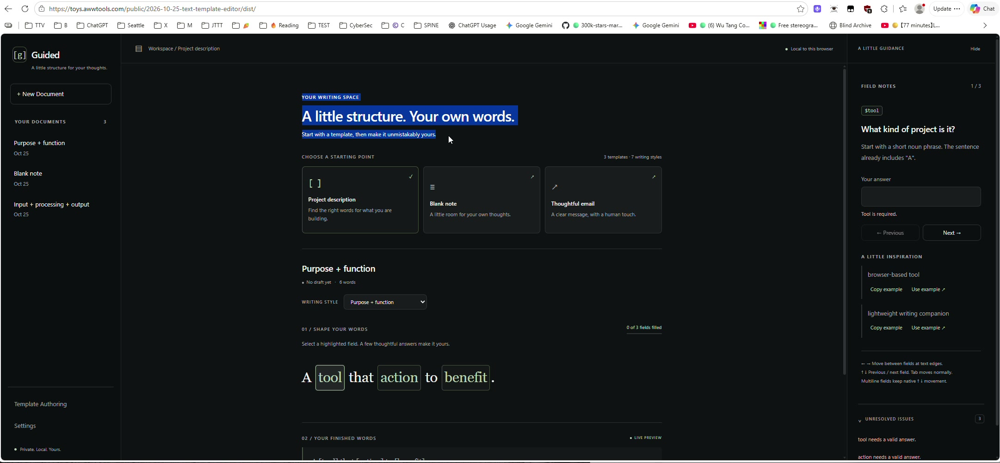

*Frame 08 - 17:07. The introductory headline is selected while the speaker discusses removing the promotional wording.*

## 17:19 - Remove the combined template and style counter

We have a counter showing "3 templates" and "7 writing styles."

This is a lazy way to show information. What if I said, "Three mothers and sixteen children"? Does every mother have an equal number of children, or does one have all sixteen and the others none?

It is the same problem. This is a horrible way to show statistics that we do not need.

Remove it.

## 18:13 - Show a rendered example before selection

The template selection is definitely lacking a preview. I have to click a template to preview it.

It would be nice if hovering also showed a preview with examples. We could put some values in there - ask the agent to provide meaningful sample values - and show a dummy rendered result on hover.

That would be cool: a rendered example before I select the template.

## 19:19 - Writing style is an important decision

"Writing style" is very important. It is another decision the user needs to make.

Make it larger and make it clear that this is not just an ordinary, optional control. It is a decision point.

Why are we displaying it as a plain dropdown? I think we should display the items in a richer way: perhaps a rich dropdown.

Modern CSS may support a better dropdown list. Or we could use radio buttons, a list of radio buttons, or our own advanced dropdown.

The purpose is to show the user that selecting a writing style actually matters.

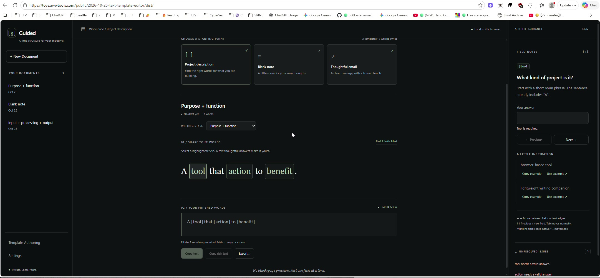

*Frame 09 - 19:40. The current Writing style selector is a compact native dropdown; the speaker is proposing a more prominent presentation.*

## 20:39 - Make the variable and the active edit obvious

The template itself is good, but I do not clearly see that it is a template. Maybe we should bring back the dollar signs.

Here is `$tool`, but it is displayed in a way that is not very readable as a variable. We can see `$action` in the side panel. Let's display the variable inside the template with a dollar sign, too, for consistency.

When I press "action" in the document, I am editing `$action` in the sidebar.

It is important to make that bigger and clearly show what we are editing. We already highlight it in the main document. Also make it obvious in the editor that the thing I am editing is `$action`.

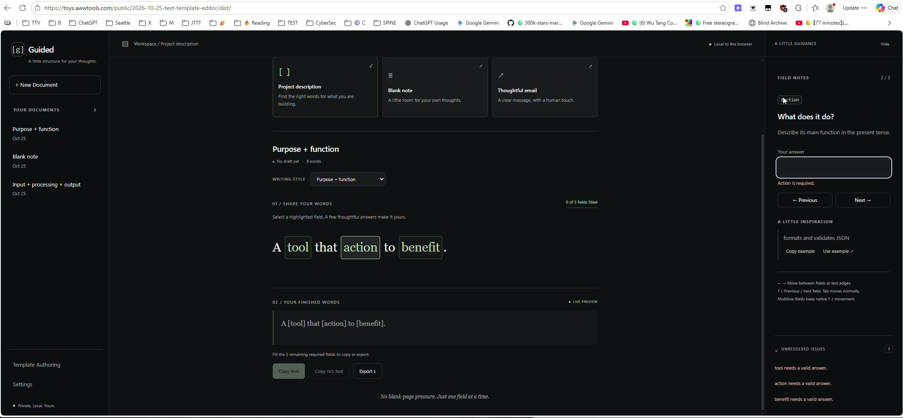

*Frame 10 - 21:43. The active field is action. Its small `$action` tag is visible in the guidance panel; the document token does not show the dollar prefix.*

## 22:04 - Examples, field labels, and the generated result

"Use example" and "Copy example" are fine.

We have a result. We need to prefill something, so let's use the examples.

"A little inspiration" should at least become "Inspiration."

And "Field notes" - what are field notes? Did somebody take notes in a field? This is bad naming. These things appear with weird names, and that is not good.

Now we have the benefit filled in, and it works. But "Your finished words" is marketing again. Make it pragmatic.

We need to rename everything. For every label, first decide whether it needs to be there. If it does, it should say specifically what the element does.

"Your finished words" - what is that? A death threat? "Finish him" from Mortal Kombat? Please rename it to something better.

Think of Microsoft Office or something like that. You will not go wrong by making the titles pragmatic and boring. I do not specifically want them to be super boring; I want them to say what the element does.

What is the result here? That is what the label should tell me.

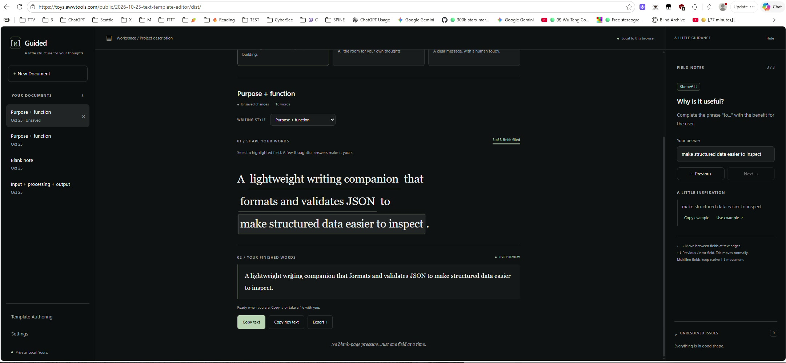

*Frame 11 - 23:04. The speaker selects the "Your finished words" label above the generated result.*

## 24:25 - A setting for browser input-history suggestions

I want a setting that prevents this annoying saved-input or recent-history popup from appearing.

Put it in the application settings. We should be able to turn off support for recent input, because this behavior is horrible in many browsers and can really confuse things.

It should be enabled by default, following whatever the user has enabled in the browser. But the user can disable it.

Then we render these fields with the special attribute that prevents that popup from appearing.

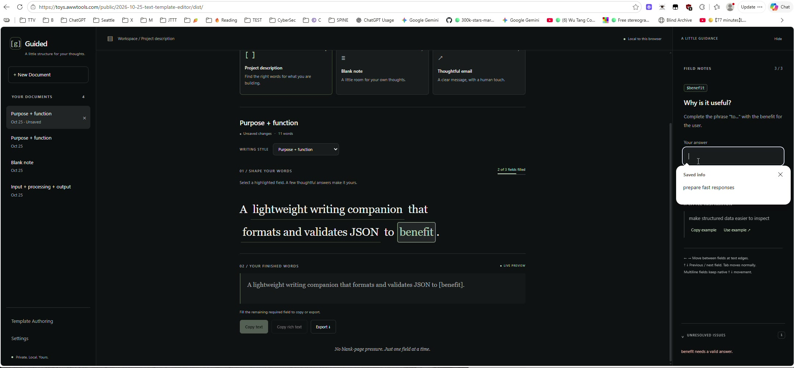

*Frame 12 - 24:45. The browser's "Saved info" suggestion is open over the answer area. This is the browser input-history popup, not the application's save confirmation or conflict dialog.*

## 25:27 - Reuse the panel behavior and collapse to the edge

We can definitely keep a separate Settings page, but we should reuse the same logic and components.

I have explained how I want the right sidebar to behave: it is draggable, there is a button to make it a sidebar, and it can collapse to the right edge.

Now I am talking about the left sidebar, the list of chat messages. We want to be able to collapse those chat messages to the right.

> Editorial note: The speaker says "right" here while referring to the left sidebar. Later, the separate template-authoring sidebar is described as collapsing to the left. This directional inconsistency has not been silently resolved.

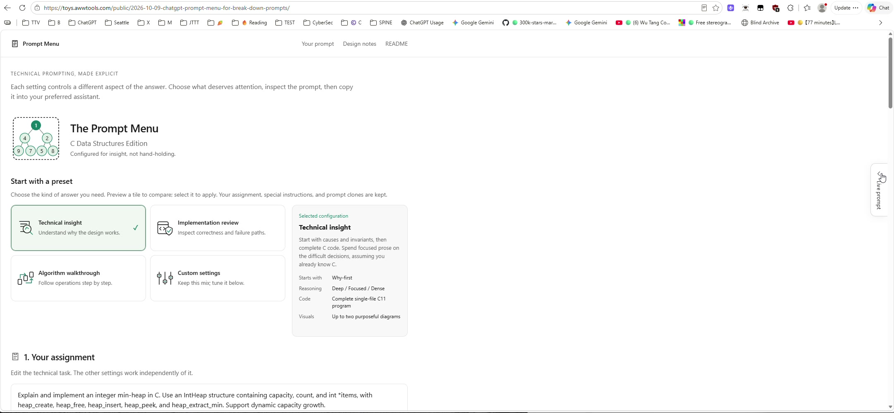

*Frame 13 - 26:33. The reference Live prompt is collapsed to a narrow edge tab, rather than leaving an empty panel-sized column.*

## 26:59 - A separate history sidebar for template authoring

Our guided-template entries - what I am calling chat messages on the left - are edits to templates, an editing history.

For Template Authoring, I want a separate left sidebar, which I can also collapse independently to the left if I want.

It should contain entries in the form of a historical chat. I also want those previous edits.

We want to save the edits as we make them. They would also be like chat messages, probably in a different table.

When we save a template, or a draft template - an editing draft - it should be the same idea.

Here we have an error: "Unknown directive." I can move away from this page even with an error.

Let's save it as a draft.

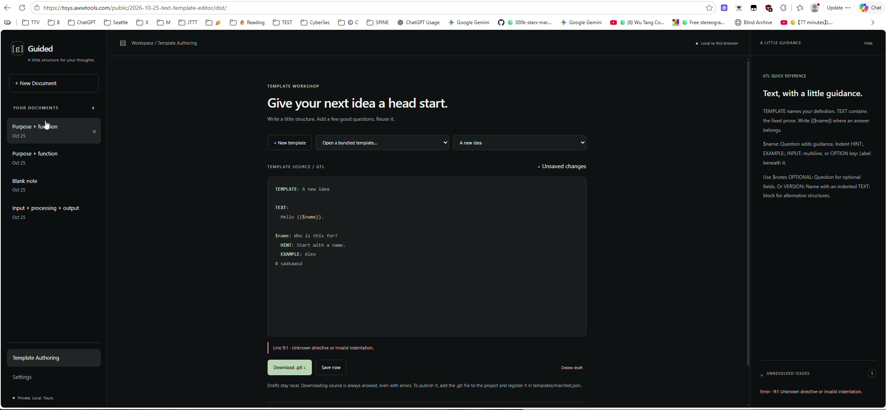

*Frame 14 - 28:08. Template Authoring contains invalid source. The error says "Unknown directive or invalid indentation," and Save now remains available.*

## 28:19 - Where was the draft saved, and how do I rename it?

It says this is a draft, so let's save it. "Save now." Okay, it is saved.

Where was it saved? Who knows. Maybe it is here. I do not know how to rename it. It is "A new idea."

I should be able to rename it. "Local template drafts" - I do not know what this thing is.

This does not let me edit the template name. How do I edit the name? I cannot find an editing capability here.

We need to rethink this. It is not totally wrong, because it has a "Live template preview." That is pragmatic. That label is very pragmatic.

## 29:19 - Remove the authoring slogans and clarify template instances

But then we have "Template workshop," "Give your next idea a head start," and "Write a little structure. Add a few good questions. Reuse it."

This is garbage. Remove it.

Instead, rethink what we can do with the template editor. How do I name the template?

And use the same kind of presentation as we have for the text created from templates. Let's call those "template instances."

We want the templates themselves to have their own chat-like history, in their own sidebar.

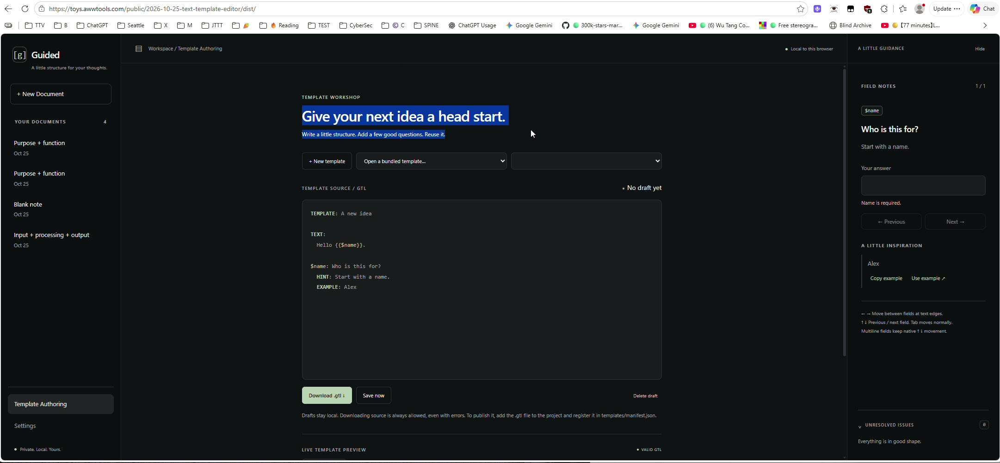

*Frame 15 - 29:30. The authoring heading and subtitle are selected as examples of wording to remove.*

## 30:12 - Settings in the main page and in a sidebar

The same goes for Settings. Why not have our own Settings sidebar?

We can open Settings in the main content panel. But maybe we can also edit settings in their own sidebar, similar to the others.

Represent the same thing using the same logic, components, and controllers. Display it as the main Settings page, and also as a sidebar.

Then, while the user is editing something, they can open that sidebar and change a setting almost instantly. That would be very good for the user.

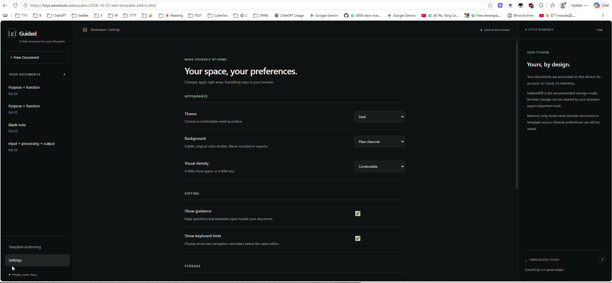

*Frame 16 - 30:33. Settings currently occupies the main workspace. The proposed sidebar would be another presentation of the same settings controls.*

## 31:19 - Reuse the reference's tiles and large selection controls

Look at how the Prompt Menu is designed. It has a much better experience.

It uses icons; maybe icons are good. It uses tiles. For our selection controls, we could use a dropdown, radio controls, or something like this.

These tiles are effectively radio buttons. When we press one, the other selected item pops back out.

"Verbosity" works the same way. "Technical depth" is another style of radio selection.

Why not use that style here? It is more coherent for users.

We also have regular radio buttons. Look how large they are. That is cool: I can clearly see what is selected.

The checkboxes are large, too. Let's reuse that kind of checkbox. I can see and select the elements, and we have a good final preview.

Why not reuse these elements and this design in our application?

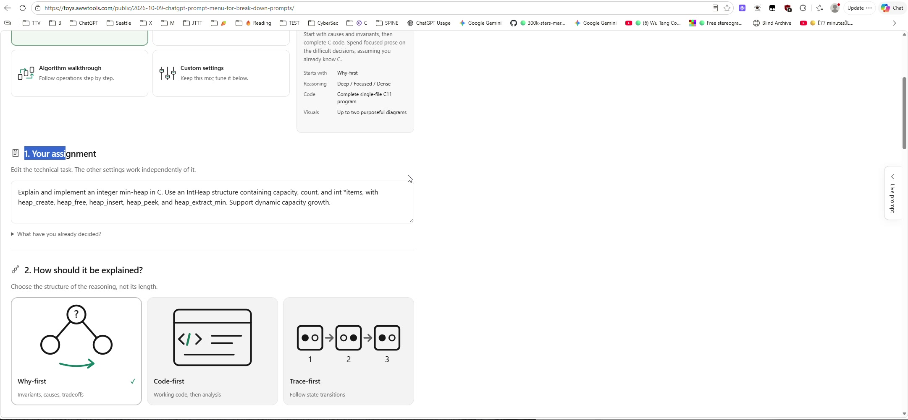

*Frame 17 - 31:30. The "How should it be explained?" section uses large illustrated, mutually exclusive tiles.*

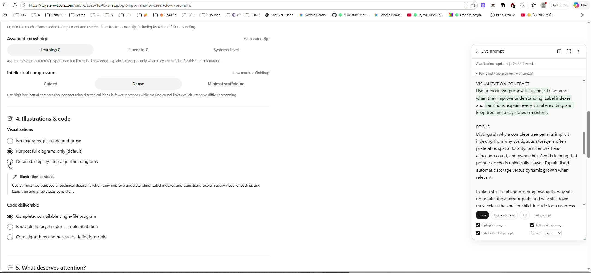

*Frame 18 - 32:40. The reference also uses large radio controls with clear labels.*

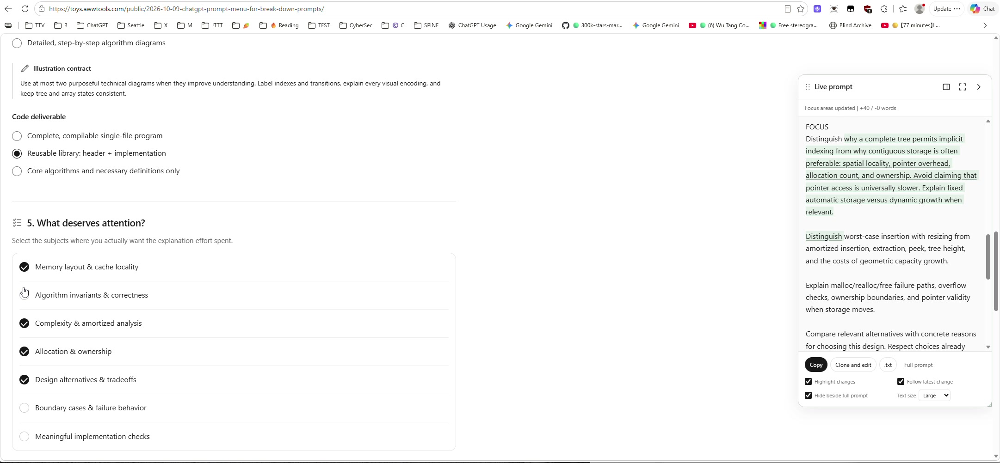

*Frame 19 - 32:52. "What deserves attention?" uses large checkbox rows with independently selected and unselected topics.*

## 33:19 - Make renaming discoverable

Finally, we need to look at these things and think about what the user expects.

For example, I want to rename my draft. There should be a button here, or an edit icon, to rename it. We need to add some icons.

## 34:00 - Keep confirmation for deletion

Let's press the X and see what happens.

Deletion asks for confirmation, and that is good.

Near Delete, we should also have an action to edit the name. And we should have Archive.

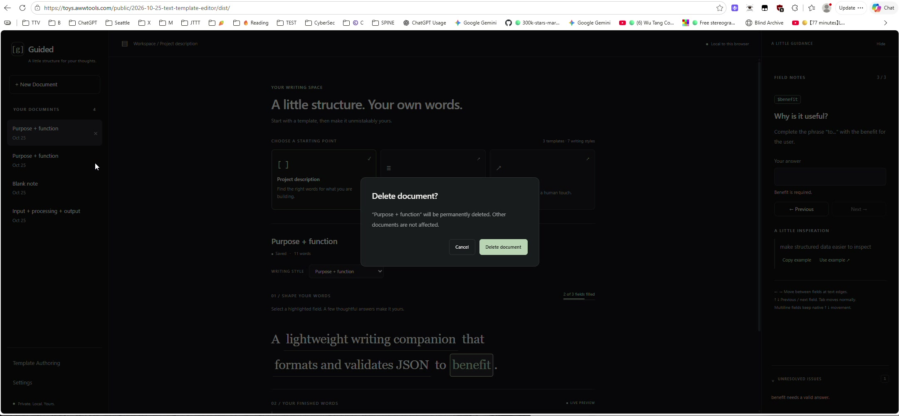

*Frame 20 - 34:08. The existing Delete document dialog asks for confirmation and identifies the document being deleted.*

## 34:38 - Archive, filtering, and restoring documents

Let's arrange the actions with Delete at the far right, then Edit and Archive.

Archive does not ask for confirmation. It just archives.

We need an archive page where we can... You know what? Right here in Documents, we could add a "Show archive" checkbox.

Or it could be a dropdown. We could select "Show recent only." In Settings, perhaps we can define what counts as recent, or show the top ten.

We could also have "Show archived" and the normal document view.

With those choices, I can see normal, unarchived documents or archived documents.

If I press the archive button on an archived document, I will... no, I will unarchive it. That means returning or restoring it.

If the document is not archived, pressing Archive archives it, and it disappears from the normal list.

I hope that makes sense. It should be common sense. If there are speech-recognition issues here, use common sense - I am dictating this.

> Editorial note: Archiving, archive filtering, and restoration are proposed behavior. These controls are not present in the recorded application.

## 36:38 - Closing

Okay. Let's see what happens with this specification.

I will stop dictating, transcribe this video, and see whether my script works.

**[37:11]** Those are the changes to implement.
