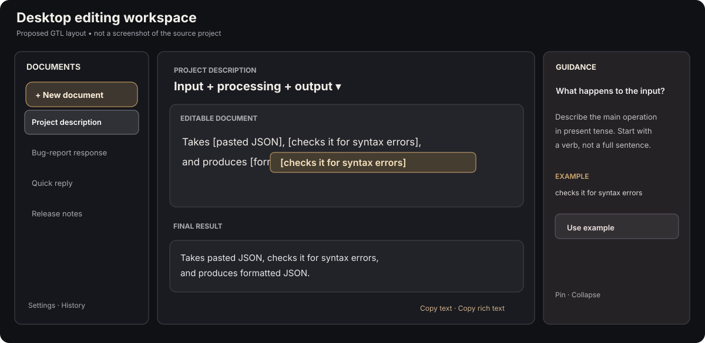
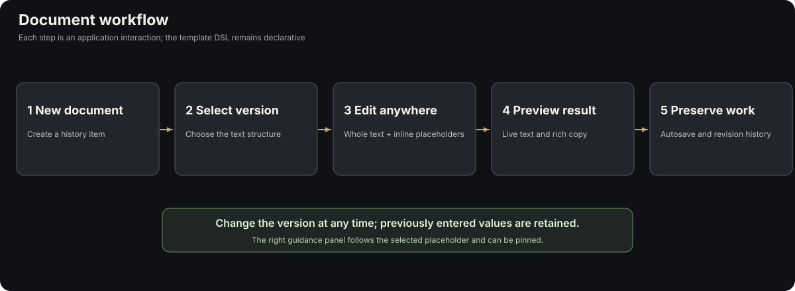
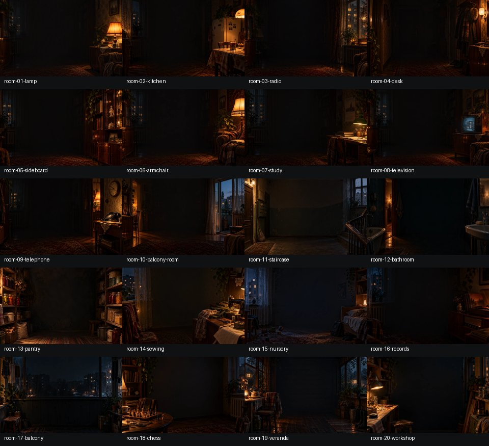
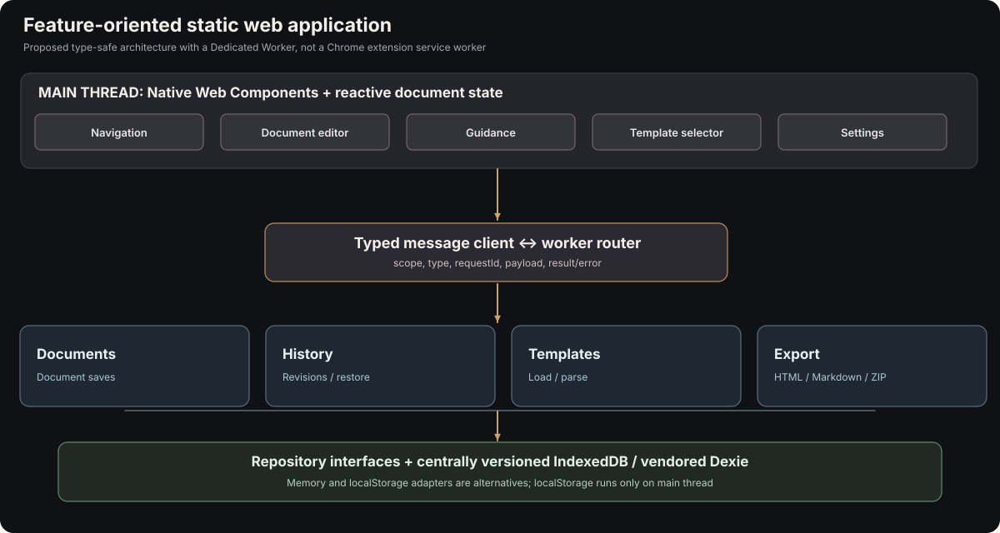
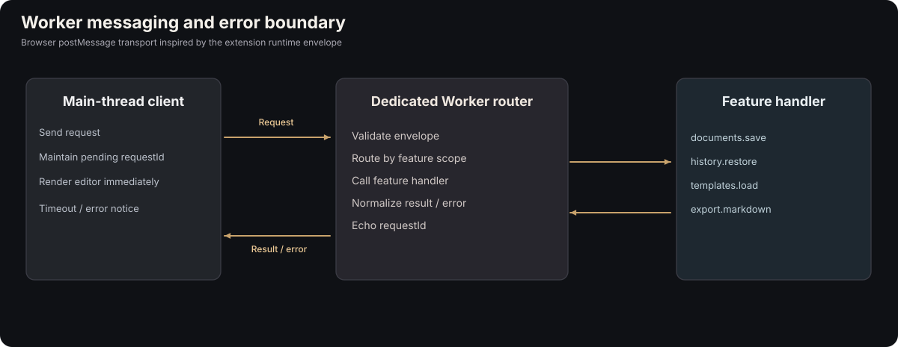
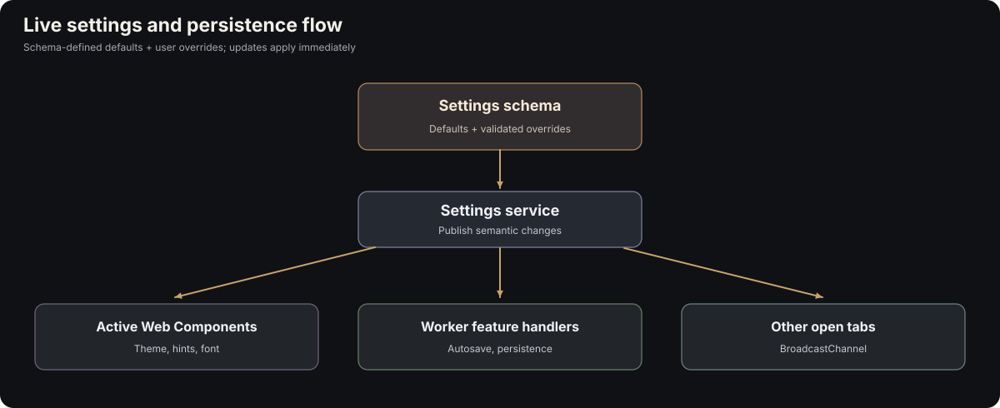

# Combined reference — GTL document editor, UX + implementation patterns

This combined briefing joins two earlier source reviews. The complete, separately readable analyses are [Report 1: UI/UX](01-chat-ui-ux-analysis.md) and [Report 2: extension architecture](02-extension-engineering-analysis.md). Their diagrams have been redrawn as editable SVGs and their cited source files copied into `../reference/` with original paths preserved.

**Not a finished application specification.** Observations about the archives are labeled separately from recommendations for the new application. Decisions not yet accepted should remain reviewable.

## Purpose and product model

The new product is a **guided text-document editor**, not a chat client, spreadsheet, or step-by-step questionnaire wizard. Every historical entry resembles a chat item visually, but represents one persistent **document**. The selected document is immediately editable. Its whole text is visible, with named inline placeholders and context-sensitive hints. A rendered, copyable result appears lower in the same document. A user can fill placeholders in any order, edit ordinary text, switch template versions, preserve previous answers, revisit earlier documents, and use revision history to recover past edits.

The template DSL should stay minimal. The latest working design sketch is:

```text
TEMPLATE: Input + processing + output

TEXT:
  Takes {{$input}}, {{$processing}}, and produces {{$result}}.

$input: What does the user provide?
  HINT: Describe the original data or information.
  EXAMPLE: pasted JSON

$processing: What happens to the input?
  HINT: Describe the main operation.
  EXAMPLE: checks it for syntax errors

$result: What does the application produce?
  HINT: Describe the final output.
  EXAMPLE: a readable formatted version
```

Optional `VERSION` blocks would choose between a handful of static alternative text structures. **Do not import the old imperative GTL design's `COMPOSE`, `WHEN`, `FOR EACH`, `FRAGMENT`, policy options, or catalog registry without a concrete new requirement.** The previous specification grew too complicated, and the user deliberately restarted from a document-centric model.

## Joined diagram: user experience



A dark desktop shell holds: (1) a vertical document history and New Document command, (2) a generous central editing column, and (3) a nonmodal contextual guidance dock. The right panel tracks the focused placeholder, can be pinned, and lets the user copy example text without hiding the document. On narrow screens, navigation becomes a drawer and guidance becomes a compact panel that does not obscure the caret.



The user selects a template/style **inside** a new document; its complete text appears immediately. The application handles field focus, live result, retained values across version switches, undo/redo, autosave, revision history, and copy/export. These are app services, not DSL instructions.

## What the chat-source project contributes

Source: `sovet-rdtl-0.13.1-source(1).zip`.

- `sovet-rdtl/styles.css`: restrained black palette, 256px sidebar, readable center column, responsive drawer, focus/accessibility conventions.
- `sovet-rdtl/src/ui/components/sov-sidebar.js`: vertical history, current selection, create/select/delete events.
- `sovet-rdtl/src/ui/components/sov-app.js`: app shell and UI coordination.
- `sovet-rdtl/src/ui/components/sov-message.js`: prominent readable message treatment and contextual info affordance.
- `sovet-rdtl/src/ui/components/sov-origin-panel.js`: async contextual information, stale-request protection, focus return; **adapt into nonmodal pinned guidance**.
- `sovet-rdtl/src/ui/components/sov-backdrop.js`: responsive decorative WebP backgrounds, small image cache, failure handling.
- `sovet-rdtl/src/ui/dom.js`: light utility code, SVG icons, `CustomEvent` with bubbling/composed.
- `sovet-rdtl/src/adapters/local-storage.js` and `src/app/chat-service.js`: state isolation, storage errors, concurrency safeguards.

The chat application uses **Custom Elements with light DOM**, not Shadow DOM. The document editor is new implementation work; no existing source component can simply be renamed into a robust rich-text editor.



## What the extension-source project contributes

Source: `browser-extension-src.zip`.

- `src/content/libs/dexie-4.2.0.js`: vendored Dexie UMD distribution included in this package under `library/`.
- `src/background/tab_trail_service.ts`: repository/store abstraction with Dexie and memory implementations.
- `src/content/runtime_messaging.ts`: typed message envelopes, request correlation, structured failures.
- `src/settings/settings_runtime.ts` and `src/settings/settings.ts`: schema-driven settings, defaults/overrides, reset behavior, dynamic controls.
- `src/background/service_worker.ts`: example of worker routing and DB ownership, **also an example of a monolith to avoid**.
- `src/vendor/retroos-ui-v001/src/components/field.ts` and `src/core/styles.ts`: real TypeScript Shadow DOM component patterns and style adoption.
- `src/vendor/retroos-ui-v001/tsconfig.json`, `scripts/build.mts`: TypeScript/Bun strict-build conventions.
- `src/content/atools/session-snapshot-v001/js/session_snapshot_zip.ts` and Markdown conversion utilities: export pipeline references.



The source is a **Chrome extension**. For the static website, replace extension messaging with browser Worker `postMessage`, favor a Dedicated Worker for Dexie/processing, and reserve an optional website service worker for offline assets. Use feature folders to own coherent domain capabilities rather than putting all logic into one worker file. Keep the main-thread editor reactive without per-keystroke worker RPC.



## Proposed system boundaries

| Subsystem | Responsibility | Execution |
| --- | --- | --- |
| Document editor | Caret, selections, inline placeholder UI, undo/redo, immediate updates | Main thread |
| Document state/model | Semantic text/placeholder nodes, current values, active version | Main thread; serializable |
| Guidance | Questions, examples, pin/focus behavior | Main thread |
| Templates | Static file loading, minimal DSL parse, cached definitions | Worker or main thread depending on cost |
| Documents feature | Create/list/load/save/delete | UI + feature worker handler |
| History feature | Recoverable revision snapshots, restore | UI + feature worker handler |
| Settings feature | Schema/defaults, live updates, persistence choice | Main thread; worker notification |
| Export feature | Plain/rich HTML/Markdown/ZIP | Main + optional worker |
| Data platform | Repository interfaces, IndexedDB/Dexie initializer | Worker; optional main-thread adapters |
| Navigation | Vertical document history, New Document | Main thread |

A feature may contain `ui/`, `worker/`, and `storage/`, but **only when needed**. Keep schema migrations centrally coordinated, with feature repositories owning their operations.



## Deployment and libraries

Build with Bun; use modern TypeScript with strict checks; keep npm runtime dependencies out of the deployed app. Vendor required runtime JS explicitly, retaining license notices. Copy static HTML, compiled bundles, selected assets, `.gtl` template files, and a generated manifest into `dist/`. Host as ordinary files on static hosting.

`Dexie 4.2.0` is included exactly as supplied; its **UMD module-worker loading must be proved**. `JSZip 3.10.1`, `markdown-it 14.2.0`, and `Turndown 7.0.0` are available as optional vendor files for export/conversion. They need not be loaded in the first release.

## First prototype / acceptance scenario

A user opens the static site, creates a document, chooses one of the five description patterns, sees the whole sentence at once, selects a placeholder, sees a stable question/hint/example, types an answer, edits surrounding prose, switches versions and back without losing values, scrolls to the final result, copies plain/rich text, leaves the document, and reopens it with edits intact when persistence is enabled.

No chat composer, agent backend, dynamic condition language, extensible runtime plugin system, or large settings panel is needed for this prototype.

## Handoff to the next specification

Use this kit as **evidence and reference**, not as an instruction to implement every possible feature. Specific implementation decisions still require experiments: selection/caret/IME in the editor, Shadow DOM boundary, Dexie in a Bun module worker, atomic document+history saves, concurrency, clipboard fidelity, settings cross-tab changes, and storage migration.

**Full detailed reviews:** [01 UI/UX](01-chat-ui-ux-analysis.md) and [02 extension architecture](02-extension-engineering-analysis.md).

## Original CLI inspiration

The user-supplied revised PowerShell helper is copied to `../reference/powershell/Add-Project.ps1` as a third, optional source. Its guided five-style descriptions, examples, preview-before-accept workflow, and draft-recovery concerns motivated the document editor. See [07-original-wizard-and-recovery.md](07-original-wizard-and-recovery.md).
