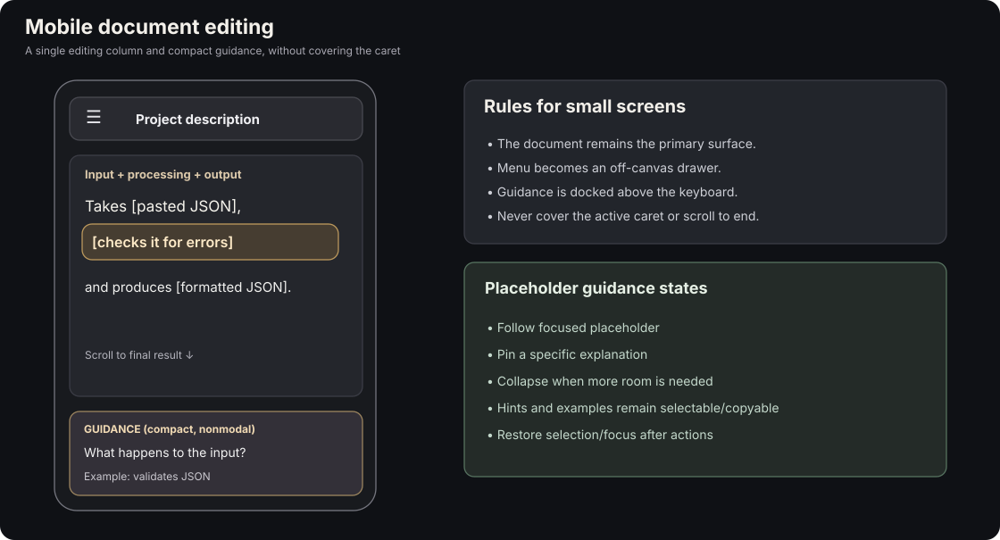

# Report 1 — UI/UX source analysis: SovietRDTL as the editor's visual reference

**Source archive:** `sovet-rdtl-0.13.1-source(1).zip`  
**Extracted references:** `../reference/sovet-rdtl/sovet-rdtl/`  
**Origin:** Reconstruction and extension of the earlier conversation's detailed UI/UX analysis.  
**Scope:** UX, visual components, events, state, accessibility, layout. The chat engine's language/corpus behavior is **not** proposed for reuse.

The strongest reusable pattern is a *conversation-history layout with document-centered reading*. The GTL application would display multiple editable documents in vertical navigation; each document is presented as a readable, editable message-like page, not a chat conversation. There is **no conversation composer**. Its central editing surface contains full text, inline placeholders, a nearby nonmodal guidance area, and a rendered/copyable result below.


## 1. Observed reference architecture

The application is a small dependency-light ES-module frontend using browser Custom Elements, shared CSS, a service for conversational state, and localStorage persistence.

| Original file / element | Observed responsibility | Proposed application counterpart |
| --- | --- | --- |
| `src/ui/components/sov-app.js` / `sov-app` | Application shell, UI coordination, menu/dialog events | App shell and document coordinator |
| `src/ui/components/sov-sidebar.js` / `sov-sidebar` | New chat, history list, current selection, deletion | Vertical document navigation |
| `src/ui/components/sov-chat.js` / `sov-chat` | Scrollable message list, incremental updates, scroll positioning | Scrollable document workspace; **not** a chat log |
| `src/ui/components/sov-message.js` / `sov-message` | Readable message body, role/tone styling, contextual info | Individual document/message-like content treatment |
| `src/ui/components/sov-origin-panel.js` / `sov-origin-panel` | Modal explanatory content, async load, focus restoration | Pinned or docked placeholder guidance; **not** modal |
| `src/ui/components/sov-backdrop.js` / `sov-backdrop` | Responsive background images, loading and cache | Decorative workspace backgrounds |
| `src/ui/components/sov-composer.js` / `sov-composer` | New message, per-chat draft, attachment/media | No direct counterpart; only draft-awareness inspiration |
| `src/ui/dom.js` | Element builders, SVG icons, bubbling CustomEvents | Native UI/event helper principles |
| `src/adapters/local-storage.js` | Persistent state, validation, concurrent-tab conflict detection | One possible storage adapter, not primary database |
| `src/app/chat-service.js` | Observable chat service and state operations | Reactive document store/service |
| `styles.css` | Dark tokens, layout, responsive behavior | Design token and layout reference |

**Technical accuracy:** these components use *Custom Elements rendering into light DOM*. The inspected files use `replaceChildren()` / `append()` and a global `styles.css`; they do **not** call `attachShadow()`. The new app can use Shadow DOM selectively, but should not describe it as an observed property of this archive.

## 2. Visual model

Observed CSS facts in `sovet-rdtl/styles.css`:

- Sidebar width: `256px` desktop.
- Reading area: centered message column with maximum width around `840px`.
- Dark palette: `--bg: #101113`, `--sidebar: #0d0e10`, `--surface: #27282b`, `--text: #f2f1ef`, `--muted: #b2b2b7`, `--line: #343539`, `--focus: #d1d9ec`.
- Large, comfortable message text: approximately 20px desktop / 19px mobile, with larger opening text and differentiated tone surfaces.
- Responsive navigation: sidebar shifts to off-canvas treatment below approximately `767px`, with overlay and accessible focus management.

The target design should preserve the *quiet reading column*, understated dark surfaces, prominent current document, and clean typography. Add a third region to the right on sufficiently wide screens for persistent guidance.

The reference's assistant/user-aligned message bubbles should **not** be transferred literally: one GTL history item represents one document; the document editor is not a sequence of alternating speakers.

### Proposed desktop regions

1. **Left sidebar:** New Document at the top, vertical document history, active item, renaming, deletion, optional history and settings links.
2. **Center document:** Template/style selector near top, whole editable text, inline placeholders, optional document metadata, final rendered output further down, copy/export affordances.
3. **Right guidance dock:** Always-readable question, hint, grammatical form, example text, keyboard actions, and a pin/collapse control.

A new document is created *from* a template. **New Document** should be the principal action, while **Edit Template** denotes authoring the reusable definition. This avoids conflating user documents and template sources.

## 3. Vertical document history

`src/ui/components/sov-sidebar.js` renders a New Chat button and a list of chat items. Selection sets the CSS class `.selected` and `aria-current="page"`. UI actions emit `new-chat`, `select-chat`, `delete-chat`, and `clear-history` through the shared `emit()` helper.

Reuse these interaction concepts, but rename the domain:

| Chat project | GTL application |
| --- | --- |
| Chat | Document |
| New chat | New document |
| Chat title | Document title |
| Chat history | Document list/history |
| Selected chat | Active document |
| Message body | Current editable content |
| Composer draft | Unsaved document edits |
| Clear history | Manage/clear documents |

A document needs a stable identifier, selected template/version, placeholder values, modified prose, created/edited timestamps, and recoverable historical revisions. Switching the sidebar selection should restore the document exactly rather than start a wizard.

Search, rename, duplicate, sort by activity, delete, and restore are reasonable future navigation actions. **Do not** put any of them into the template DSL.

## 4. New document creation


**Proposed interaction:** Click **New Document** in the sidebar; a document opens immediately. At its top, select one of the five original description patterns, each illustrated by its purpose and example. Once chosen, the complete text appears *in place*, with placeholders already visible and selectable.

The original five styles:

1. Purpose + function: `A [tool] that [action] to [benefit].`
2. Problem + solution: `Helps [audience] [problem] by [approach].`
3. Input + processing + output: `Takes [input], [operation], and produces [output].`
4. Features + technology: `A [tool] built with [technology], featuring [feature 1] and [feature 2].`
5. Structured project profile: `A [tool] for [audience], providing [workflow] through [detail].`

All questions and answers are accessible in any order. A user may fill `$result` before `$input`, edit surrounding prose, or change the version later. An answer stored under a shared placeholder name should remain available when the corresponding version is reselected. Inactive version-specific values are retained but need not be displayed in the current document.

This is deliberately **not** a step-by-step question wizard and **not** a chat input interface.

## 5. Contextual hints and placeholder focus

The original `sov-origin-panel.js` demonstrates a contextual information panel. It opens from an info button in eligible `sov-message` nodes, fetches explanatory information, guards against stale async responses using a request counter, restores keyboard focus after closing, and contains link-policy checks.

Adapt the interaction, not its modal behavior. In GTL, guidance should be **nonmodal, nonintrusive, and stable** while the user types:

- Focus an inline placeholder → show its question, hints, expected grammatical form, and examples in the guidance panel.
- Clicking or selecting hint/example text should not clear the editor value, move the document caret, or close the panel.
- Support modes: **Follow focused placeholder**, **Pin one placeholder**, **Collapse panel**.
- Keep the active editing location visible; never cover it with a popover if room exists for a docked panel.
- Maintain independent panel scrolling on desktop.
- On mobile, use a compact bottom panel or dedicated auxiliary view that respects the on-screen keyboard and visible caret.
- Examples are selectable and copyable; "Use example" can fill the placeholder, but never automatically replace the user's answer.

Example guidance payload:

```text
What does the application produce?
Expected form: noun phrase
Hint: Describe the final artifact, not another complete sentence.
Example: a readable formatted version
```

## 6. Placeholder appearance and editor interaction

A filled placeholder should read as text with *subtle* affordances (e.g. underline, slight color shift); an unfilled one can display its identifier in a more visible style. The selected placeholder receives a stronger focus indicator. Avoid giant embedded form controls that turn prose into a spreadsheet.

The center must support genuine editing of ordinary text. For example, the author can change `Takes` to `Accepts`, delete a clause, or insert a placeholder directly at the caret without altering the reusable template definition.

A proposed internal document structure is:

```text
Document
  Text("Takes ")
  Placeholder(input)
  Text(", ")
  Placeholder(processing)
  Text(", and produces ")
  Placeholder(result)
  Text(".")
```

This permits repeated placeholders to reference one shared value. It also separates ordinary text edits from placeholder identity.

A first test may use `contenteditable` plus stable, isolated placeholder nodes and a distinct value editor. **Do not assume this is already solved.** Test selection, keyboard navigation, paste, undo/redo, IME composition, newline handling, and selection preservation before choosing an editor strategy. Rebuilding the editor DOM on each keystroke is likely to break caret position.

## 7. Same-page final result and clipboard

The final rendered result belongs below the editable content, in the **same document**, not in a separate modal or chat message. A compact copy command may also live in the document header.

Supported outputs should ultimately include:

- `text/plain` for paste into terminals, source editors, and generic text fields.
- `text/html` for rich text, preserving semantic paragraphs, emphasis, headings, and lists.
- Optional export as Markdown, HTML file, plain text, or ZIP.

The exported material should come from the semantic document model. Never copy sidebar chrome, hints, placeholder outlines, artificial dark background, or interactive editor controls. Rich output must remain readable when pasted into light-themed applications.

Clipboard access should have a plain-text fallback when rich clipboard APIs are unavailable.

## 8. Backgrounds and visual atmosphere

The chat project includes **20 room compositions** and desktop/mobile WebP variants. `src/ui/components/sov-backdrop.js` keeps a small cache (at most three decoded entries), uses a `<picture>`/`<source>` pair for mobile imagery, loads asynchronously, and falls back to a plain background after failures. The decoration does not capture pointer interactions.


Recommended new-application directions: dark writing desk, quiet library, dim workstation, and neutral charcoal texture. Start with plain black plus a *small* set of optional images, and do not make backgrounds mandatory for readability.

A small subset of **actual source WebP images** is included in `../assets/source-backgrounds/`, including paired desktop/mobile images for room-04-desk, room-07-study, room-17-balcony, and room-20-workshop. These are aesthetic reference assets, not finalized GTL artwork.

## 9. Component communication and Shadow DOM

The chat reference uses `src/ui/dom.js` to construct nodes and emit `CustomEvent(type, { detail, bubbles: true, composed: true })`. Child components declare semantic user actions; `sov-app` coordinates state changes; services notify listeners.

A proposed GTL component outline:

```text
<template-app>
  <document-sidebar>
  <document-workspace>
    <document-header>
    <template-selector>
    <document-editor>
    <document-result>
  <guidance-panel>
  <settings-panel>
```

Proposed events: `document-create`, `document-select`, `template-select`, `placeholder-focus`, `placeholder-change`, `document-change`, `copy-result`. Prefer a central application state/service over uncontrolled component-to-component event chatter.

Use Shadow DOM for **well-isolated UI widgets** such as navigation, settings, guidance, and simple inputs. Experiment before forcing the *rich document editor* into Shadow DOM; selection and clipboard behavior are more complicated across boundaries. Public component theming can use CSS custom properties and selected `::part()` hooks.

## 10. Editing history, autosave, and storage

`src/adapters/local-storage.js` performs state validation, JSON serialization, read/write error handling, and optimistic concurrency checks by comparing the expected stored snapshot. It explicitly preserves the current in-memory conversation when persistence fails.

GTL should distinguish:

- **Immediate editing state**: changes appear in the center instantly.
- **Autosave**: persist current working state asynchronously when enabled.
- **Undo/redo**: fine-grained local editing operations.
- **Revision history**: timestamped recoverable checkpoints, not a new revision for every keystroke.

For persistence, the earlier direction was no persistence, localStorage, or IndexedDB (Dexie); a shared persistence contract is preferable. Switching storage modes raises a migration/copy question to resolve in the application specification.

The original PowerShell recovery request also motivates saving enough document state to recover from failures. Autosave and durable history are separate concerns.

## 11. Mobile and accessibility

The reference shifts navigation below ~767px and uses mobile menu focus trapping, focus restoration, reduced-motion support, and viewport/safe-area handling. Adapt those principles, not its chat-specific "scroll to latest" behavior.

For a document editor:

- Keep active caret visible when mobile keyboard appears.
- Do not forcibly scroll to the final result after each edit.
- Focus movement between placeholders must be keyboard-accessible.
- Present hint text without covering the active paragraph.
- Ensure status is not communicated by color alone.
- Keep the full document readable without an always-open side panel.



## 12. What to reuse, adapt, or exclude

| Reference behavior | GTL treatment |
| --- | --- |
| Dark shell and typography | Reuse design principles |
| Vertical conversation history | Convert into vertical document history |
| Readable message cards | Adapt to document display |
| Contextual origin dialog | Adapt to persistent guidance |
| Background cache/layering | Reuse idea |
| Custom Elements/event emitters | Reuse principle |
| localStorage state service | Study for fallback adapter and conflict errors |
| Per-chat drafts | Adapt to per-document editing state |
| Chat message composer | **Exclude** |
| AI response engine and emotional tones | **Exclude** |
| Typing animations and auto-scroll | **Exclude** |
| Audio attachments and recording | **Exclude initially** |

## 13. The key UX prototype

Build one short but realistic flow before designing many components: create a document; choose Input + processing + output; see the full sentence immediately; click a placeholder and view stable guidance; enter values in any order; edit ordinary words; change the version while retaining entered values; scroll to the rendered result; copy plain and rich text; leave and reopen the document.

The test is successful only if this experience **feels like editing a document**, not completing a questionnaire.
