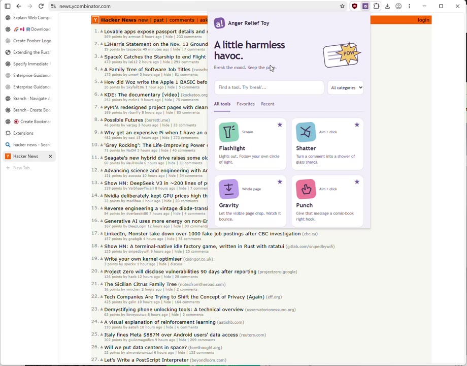
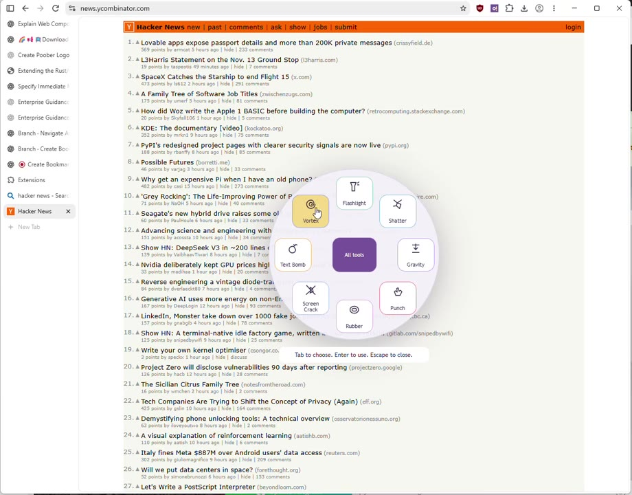
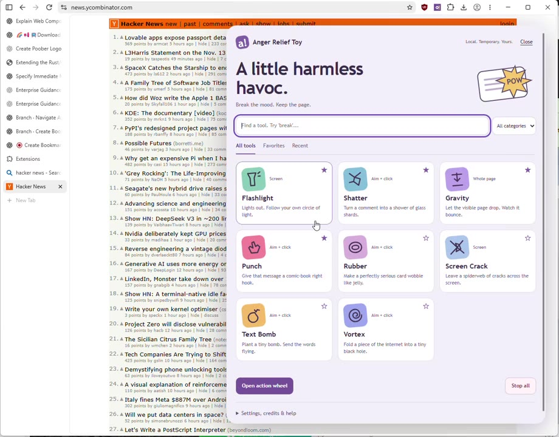
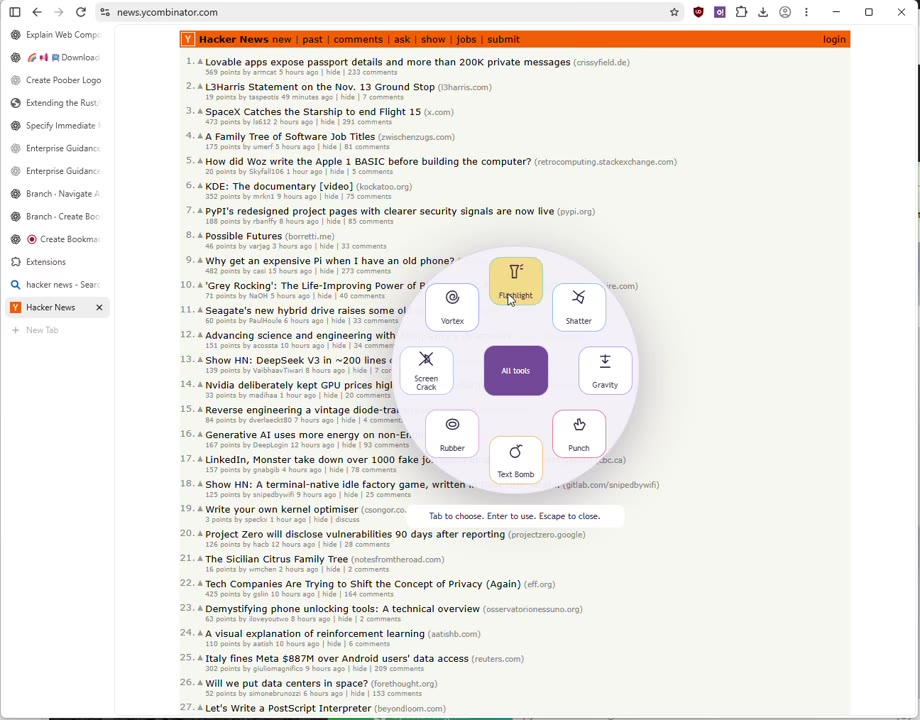
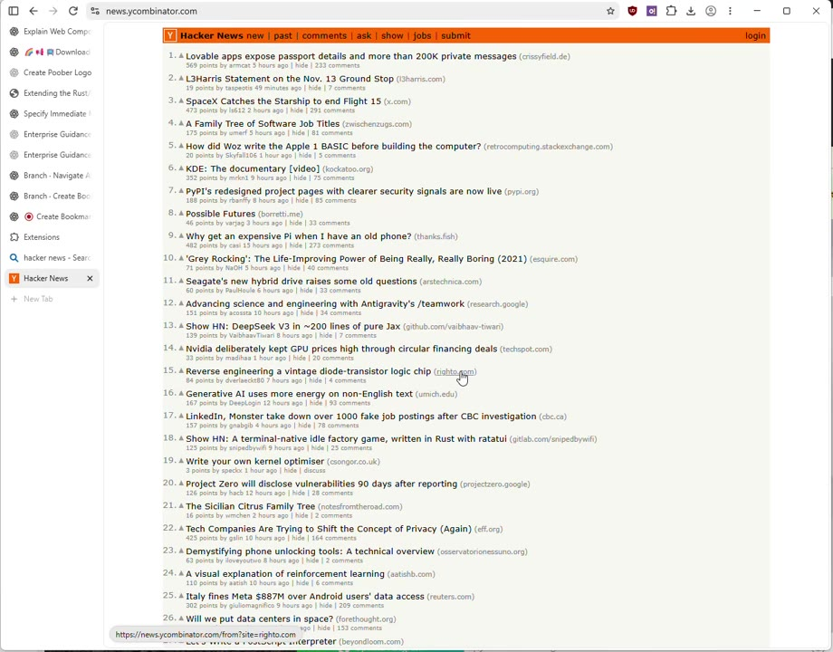
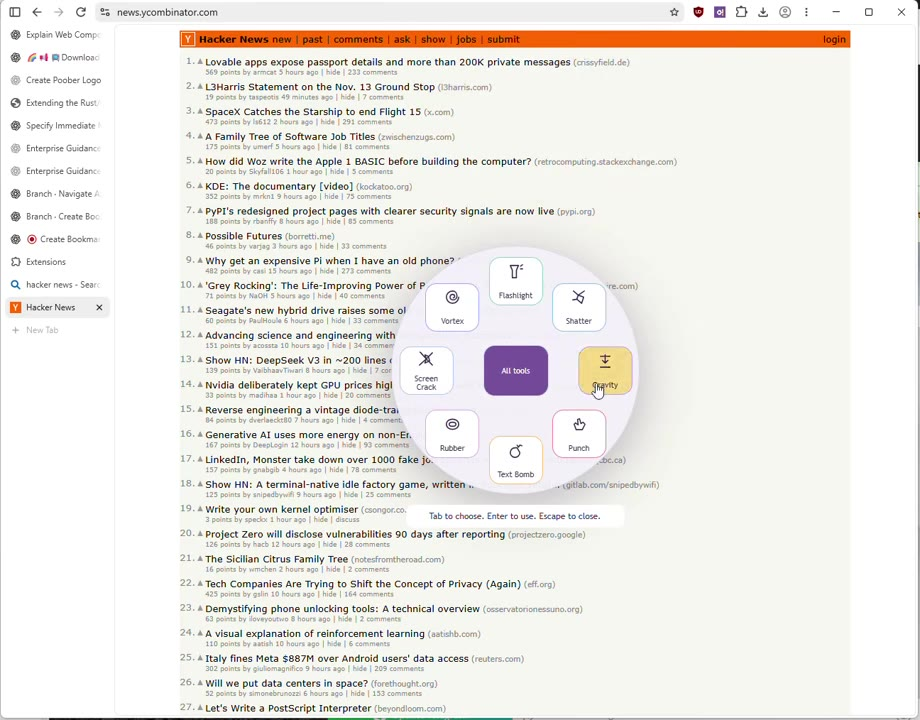
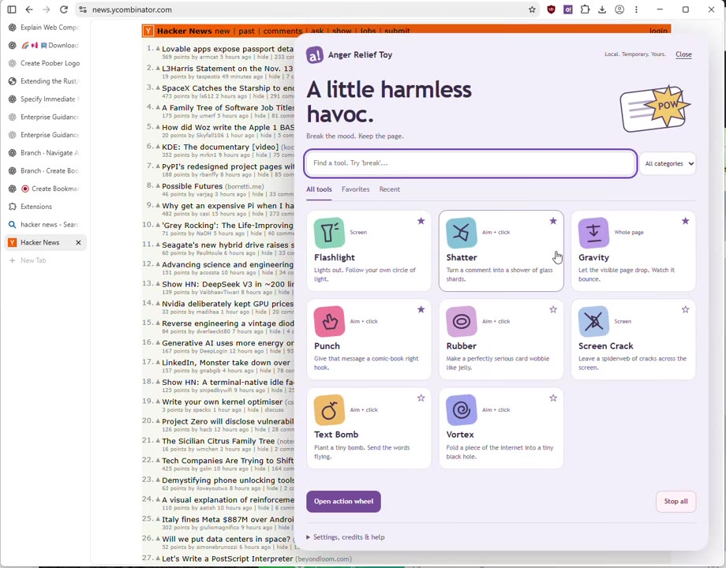
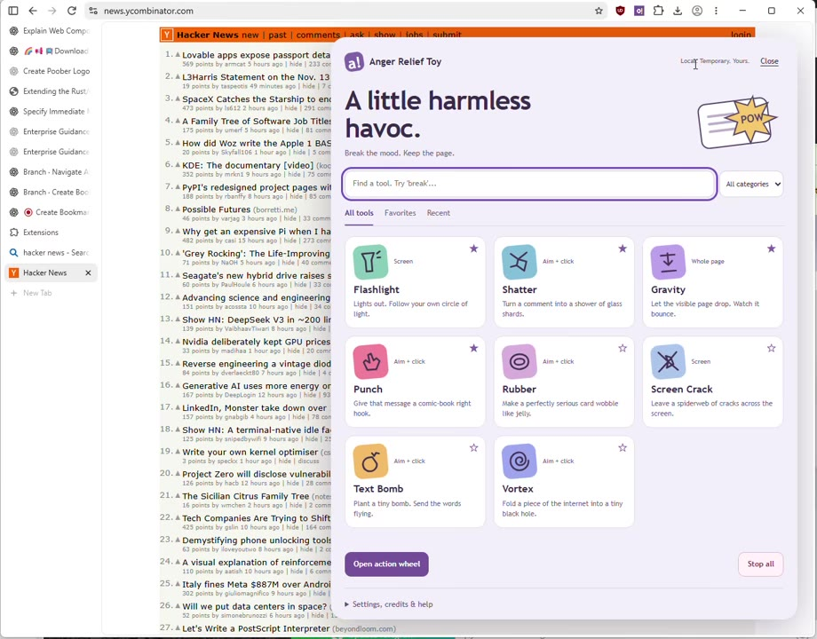
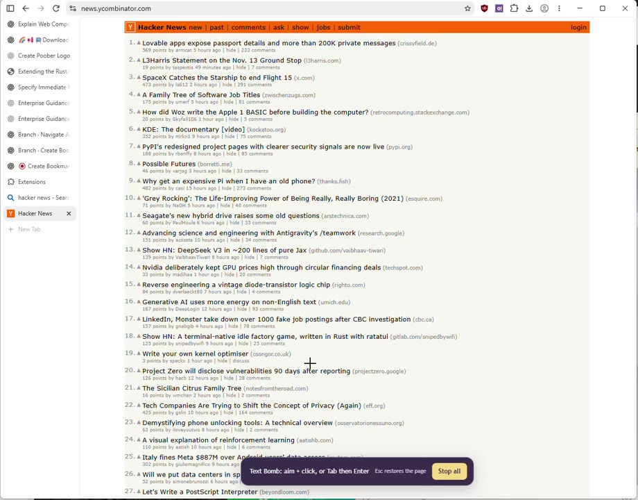

The next stage of the project focuses on improving how people interact with the browser extension. The initial implementation has already established an important foundation: users can browse a collection of visual effects, select an effect, and apply it to elements on a webpage. However, the current experience still feels more like launching individual demonstrations than using a collection of playful, interactive tools. Users must repeatedly navigate through menus, selected effects disappear too quickly, and the interface does not always communicate what the user is holding, what they can do next, or how to continue interacting with the page. We want to address these problems by making the extension feel less like a conventional software utility and more like a small game that exists on top of any webpage.

Consider Andrew, who is reading a discussion on Hacker News and encounters a particularly irritating comment. He opens the extension, finds Punch, selects it, and clicks the comment. The comment shakes, receives a cartoon-style impact, and briefly looks as though it has been physically struck. The animation itself is entertaining, but the experience becomes frustrating when Andrew wants to punch another comment. In the current implementation, the effect finishes, the interaction disappears, and Andrew must navigate back through the interface to use it again. We want to eliminate this interruption. When Andrew selects Punch, he should feel as though he has equipped a tool, just as a player equips a weapon or item in a video game. After punching the first comment, the animation can finish, but Punch remains selected. Andrew can immediately click another comment, then another, without repeatedly opening the extension. The selected tool remains available until he deliberately switches to something else or puts it away.

This distinction between selecting a tool and executing its effect is central to the redesign. A punch is a short animation, but the act of holding the punching tool is a continuing interaction. The same applies to Text Bomb: Alice should be able to select a bomb, place it on a paragraph, watch the text explode, and then immediately place another bomb somewhere else. Other tools behave differently. Flashlight, for example, is not something that should automatically disappear after three seconds. When Alice activates Flashlight, she expects to move the illuminated area across the page for as long as she wants. The extension should recognize these different interaction patterns and give users control over how long effects remain available. Temporary animations can complete naturally, while continuous effects remain active until the user chooses to stop them.

We also want to make the process of selecting and switching tools much faster. At present, users can open the extension through the browser toolbar, but repeating this process interrupts the flow of interaction. The implementation already includes a keyboard shortcut for opening the action wheel, yet that shortcut is not sufficiently visible or explained. We plan to make it a primary interaction method. The user should be able to press a memorable shortcut, see the action wheel appear directly over the webpage, choose a tool, and immediately continue playing. The interface itself should display the shortcut and help users discover it, rather than requiring them to search through settings or documentation. If the browser has assigned a different shortcut, the extension should display the actual assignment.

Another interaction worth exploring is a mouse gesture. Imagine Andrew holding the middle mouse button and drawing a small circle with the pointer. As he continues the gesture, a circular progress indicator appears near the cursor, gradually filling as though he is charging a special ability. After a couple of seconds, the action wheel appears, allowing him to select another tool without moving his hand away from the mouse. This could make switching effects particularly satisfying, but it also introduces a technical challenge: browsers already use the middle mouse button for navigation and scrolling. We therefore want to investigate this interaction carefully, making it optional and ensuring that it does not unexpectedly interfere with ordinary browsing. The keyboard shortcut remains the reliable primary method, while the mouse gesture becomes an additional convenience if it can be implemented safely.

The action wheel itself deserves a substantial visual redesign. In the recorded implementation, it is essentially a circular arrangement of ordinary buttons. It works, but it does not yet communicate the playful identity of the project. We are considering a design inspired by a traditional ship's wheel, also known as a ship's helm. The wheel could have a distinctive circular rim, illustrated spokes, recognizable tool icons, and subtle visual depth. Selecting an item might illuminate its segment or produce a small mechanical response, making the interaction feel more like controlling something physical. We do not necessarily want a literal wooden pirate wheel, however. The aim is a modern, polished interpretation that preserves the recognizable structure while remaining readable, responsive, and convenient to operate. The wheel should be attractive enough to become one of the extension's signature interactions, but it must never sacrifice usability for decoration.

Because visual quality is particularly important here, we want to explore several designs before implementing the final wheel. The development agent can use text-to-image generation to create alternative interface concepts, including nautical, arcade-inspired, and illustrated mechanical designs. These concepts should be shown in the context of actual webpages, not merely as isolated decorative objects. By comparing them, we can evaluate which design offers the best combination of visual appeal, readability, useful interaction, and consistency with the extension. The selected concept can then be refined and translated into functional interface components. This visual exploration should extend to the inventory toolbar, tool icons, cursor indicators, and other elements so that the entire extension feels like one coherent product.

The full tools catalog also needs attention, although its existing organization is already useful. The searchable collection, category filters, favorites, and individual tool icons provide a good foundation. The main problem is how the catalog appears and behaves when opened from the action wheel. Currently, it is positioned toward the upper-right corner of the webpage, which feels disconnected from the action that opened it and can unnecessarily obscure content. We want the catalog to open in the center of the viewport, where its purpose is immediately apparent. Users should then be able to drag the window to another location. For example, if Alice opens the catalog while reading a long article and discovers that the window covers a paragraph she wants to inspect, she can simply move it aside. Closing the catalog should dismiss that window without discarding whichever tool she previously equipped.

We also want to rethink the way the extension communicates through text. The current interface contains decorative phrases such as "A little harmless havoc", "Break the mood. Keep the page", and "Local. Temporary. Yours." Although these expressions reflect the project's playful intentions, they consume space without helping users understand what they can do. We would rather let the visual design and the effects themselves provide the humor, while the interface text remains concise and useful. A heading such as "Choose a tool" tells the user exactly what the window is for. A button labeled "Open action wheel" communicates a clear action. By contrast, vague labels and tiny decorative captions make an already unfamiliar interface harder to understand. We plan to review every heading, button, instruction, tooltip, and status message, removing unnecessary wording and improving the readability of information that actually matters. The Close button, for example, can become more visually expressive while remaining unmistakably recognizable as a control for dismissing the window.

A particularly important addition will be a small inventory-style interface that shows which tool the user has equipped. Think of the inventory bar in Minecraft or the selected weapon indicator in an action game. When Andrew equips Punch, a compact toolbar appears near the bottom of the page, showing a recognizable boxing-glove icon, the name of the tool, and a convenient way to switch or put it away. When he selects Text Bomb, the inventory updates to display a bomb icon. The toolbar persists between individual animations, making it clear that the selected tool remains available. It also gives users a predictable place to manage their current interaction without reopening the extension's popup.

To strengthen this experience, we want to experiment with a small equipped-tool indicator near the mouse pointer. When Alice selects Text Bomb and begins aiming at a paragraph, a miniature bomb icon might follow the cursor at a comfortable distance, perhaps slightly below and to the right. This would resemble the visual feedback found in games when a player is holding a particular item. The indicator should communicate what is equipped without obscuring the precise target or interfering with the user's clicks. Its appearance should match the icons used in the action wheel, searchable catalog, and inventory toolbar. These components have different purposes, but they should all communicate the same selected state.

The interaction between the different interface elements must also become more predictable. Opening the action wheel should not cancel the current tool. Closing the catalog should not terminate a flashlight. Finishing an explosion should not cause Text Bomb to become unequipped. Conversely, when the user explicitly puts away the current tool, the extension should terminate its active effects, remove temporary overlays and cursor indicators, and restore ordinary browsing. This is why a generic "Stop all" button is not always the most appropriate control. We want the interface to distinguish clearly between closing a menu, ending an individual animation, and putting away the currently equipped tool. These actions may look similar in the existing implementation, but they represent different user intentions.

Throughout these changes, we want to preserve the temporary, non-destructive nature of the effects. When Andrew punches a Hacker News comment, the comment should not actually change in the website's data. When Alice shatters a paragraph, the original content should remain intact. The extension can produce elaborate visual illusions, but its interaction layer must remain separate from the underlying website's persistent state. This becomes especially important as tools remain equipped for longer periods and users interact with multiple elements in succession. The runtime must manage effect lifetimes, cleanup, target selection, and resource usage reliably, without requiring the user to refresh the page whenever something finishes.

Finally, we want to validate these improvements in the context in which users will actually experience them. A beautiful wheel shown in an isolated mockup does not necessarily look good over a crowded discussion page. A cursor indicator that looks attractive in a design concept may obscure text during real interaction. An inventory toolbar may be perfectly positioned on one webpage and interfere with content on another. We therefore want to use Playwright, wherever the development environment permits, to load the actual extension against representative webpages, capture screenshots before and after interactions, and examine whether the redesigned controls fit naturally into the surrounding content. The agent should investigate visual discrepancies, test repeated tool usage, verify cleanup, and compare the result against both the original recording and the selected design concepts.

Ultimately, the changes are intended to make the extension feel more natural, expressive, and enjoyable. A user should not have to think about extension popups, activation states, animation timeouts, or how to restart a tool. They should simply be able to summon the action wheel, choose something entertaining, and start interacting with the page. If they want to punch ten comments, they can punch ten comments. If they want to keep a flashlight active while presenting something to colleagues, they can do so. If they want to switch from smashing elements to throwing them around under simulated gravity, that transition should be quick and satisfying.

**We want to move from an extension that lets users launch funny effects to an extension that lets users play with the web.** The difference is not merely visual. It is about making the tools feel persistent, the controls feel intuitive, and the interactions feel continuous. The browser becomes a temporary playground, and the user remains in control of the experience from the moment they equip a tool until they decide to put it away.


# Change Request Specification: Interaction, Navigation, and Visual Redesign

**Specification:** `suggestions003-00-change-request-interaction-navigation-and-visual-redesign.md`  
**Feature number:** `003`  
**Revision:** `00` (initial change request for this feature)  
**Date:** 2026-11-14  
**Status:** Proposed; mutable until this change request is implemented  
**Target:** Microsoft Edge and Google Chrome, Manifest V3

> **Specification lifecycle:** Before implementation, this specification may be refined. Once the feature described here has been implemented, this revision becomes immutable. Any later changes must be captured in a new file using the same feature number and an incremented revision, for example `suggestions003-01-change-request-interaction-navigation-and-visual-redesign.md`. Keep implemented revisions intact as historical records. Assets for each revision belong in the equally named `.assets` companion folder.

## A00. Purpose, governing requirements, and priorities

### A00.1. Purpose

This change request addresses the navigation, usability, interaction design, visual presentation, and effect-lifecycle problems identified during the recorded review of the initial **Anger Relief Toy** extension. The objective is to turn the existing set of short-lived animation demonstrations into a **coherent, polished, game-like toolbox** users can invoke immediately, operate repeatedly, and control without leaving their browsing flow.

The existing searchable catalog, icons, favorites, recent tools, basic action wheel, settings, credits, diagnostics, and individual effects provide a useful foundation. **Retain and improve them; do not discard the functioning architecture.** This change request emphasizes the quality of the interaction, not the number of effects in the collection.

### A00.2. Required outcomes

The implementing agent SHALL:

1. Make the action wheel immediately accessible through a visible and verifiable keyboard shortcut, with an optional deliberately invoked mouse gesture.
2. Redesign the wheel as a professionally finished, game-inspired control with strong visual identity, readable labels, recognizable icons, and unmistakable selection feedback.
3. Create a persistent **equipped-tool** state with a compact inventory-style HUD and meaningful cursor-adjacent feedback.
4. Separate the lifetime of an equipped tool from the lifetime of its individual animation, enabling repeatable actions and continuous effects under direct user control.
5. Center and make draggable the full **on-page** tool catalog; preserve its search, navigation, and useful features.
6. Review every visible header, label, caption, tooltip, status message, and control. Remove empty marketing language, replace confusing terminology, and make controls pragmatically understandable.
7. Brainstorm visually with text-to-image generation and compare multiple mockups before implementing the final wheel and related visual controls.
8. Validate the actual packaged extension through Playwright where browser capabilities permit, and inspect before/during/after screenshots for both the intended effect and collateral UI damage.

### A00.3. Relationship to earlier specifications

Read `AGENTS.md` and the applicable specifications in `.specs/`, including `suggestions001-01-initial-main-specification.md`, `suggestions001-02-answer-questions-after-each-feature-implementation.md`, and the existing foundation increment. This revision supplements the earlier specification and supersedes earlier interaction details only when explicitly stated. Existing requirements for isolated source research, licensing, TypeScript, Bun, modular effects, privacy, non-destructive browser behavior, cleanup, and independent verification remain in force.

Apply the mandatory post-feature questionnaire to every new or substantially revised feature. A technically working animation or a visually attractive static mockup does **not** by itself constitute acceptance.

## B00. Evidence, timestamp map, and confirmed observations

### B00.1. Supplied evidence

The change request is grounded in two user-provided artifacts, included in the companion assets directory for a self-contained handoff:

- [Screen recording (~22 minutes 21 seconds)](suggestions003-00-change-request-interaction-navigation-and-visual-redesign.assets/reference-materials/screen-recording-2026-11-14.mp4), 920 × 720 pixels, with 47 selected extracted frames.
- [Initial implementation ZIP](suggestions003-00-change-request-interaction-navigation-and-visual-redesign.assets/reference-materials/anger-relief-toy-v001.zip), including the Manifest V3 configuration, popup, background scripts, content runtime, styles, effects, and accompanying specifications.

The extracted frames are time-based visual evidence. Their timestamps are video positions, not a guarantee that a single frame captures an entire animation. Use adjacent frames or the recording when judging a transient effect. The six [contact sheets](suggestions003-00-change-request-interaction-navigation-and-visual-redesign.assets/contact-sheets/sheet_1.jpg) through `sheet_6.jpg` provide a quick overview.

### B00.2. Observations by timestamp

| Time | Observed user experience | Change needed |
| --- | --- | --- |
| 01:13–02:03 | Popup shows a searchable, icon-based tool catalog and selection of Rubber. | Preserve useful structure; improve hierarchy and discoverability. |
| 02:20–02:24 | Targeting bar appears and disappears around the interaction. | Equipped state must persist independently of short animations. |
| 02:57–03:19 | Punch shows a bottom bar and a brief impact result. | Allow repeated punches without reselection; improve active-tool feedback. |
| 03:46–04:08 | Popup shows settings, credits, and help content. | Shortcut discoverability should not depend on buried help text. |
| 04:56–05:03 | Eight rectangular tool tiles form a circle around **All tools**. | Replace utilitarian radial arrangement with designed game control. |
| 05:16–07:45 | Full on-page catalog is anchored near the right side of the viewport. | Open centered and support dragging. |
| 09:13–10:33 | Catalog includes tiny labels, ornamental copy, and an understated Close link. | Comprehensive copy, readability, and header/control audit. |
| 13:25–13:47 | Text Bomb is selected, target highlighting becomes available. | Stronger equipped-tool/aiming cue with distinctive icon. |
| 14:52–15:00 | Text Bomb animation finishes and the user loses the active interaction flow. | Keep tool equipped after animation completes. |
| 15:40–16:55 | User discusses an inventory/hotbar and gesture-based switching. | Introduce compact equipped-tool HUD and quick wheel access. |
| 18:28–19:23 | Circular middle-click gesture is proposed; wheel shown again. | Prototype optional gesture and assess browser behavior conflicts. |
| 20:05–20:11 | Flashlight selected; resulting behavior does not stay visible. | Continuous tools must remain active until explicitly terminated. |

**Visual references:**



*Figure B-1. The popup has usable searchable tool cards, but help and shortcut guidance are not prominent.*



*Figure B-2. Existing wheel: individually positioned square tiles around a central All tools button.*



*Figure B-3. Full tool catalog opens near the upper right instead of centered; excessive header copy remains visible.*


*Figure B-4. Targeting status is indicated by a bottom bar, while equipped-tool feedback remains weak.*





*Figures B-5 and B-6. Adjacent recorded states around Flashlight selection; review the recording as well to judge the transient behavior.*

### B00.3. Source-confirmed causes

Inspection of the supplied implementation confirms several causes:

- The manifest already declares an `open-wheel` command suggested as `Alt+Shift+A`. The principal problem is discoverability, although actual assignment and behavior must be verified in Edge and Chrome.
- The existing runtime uses a generic effect duration, with a default of three seconds and a one-to-ten-second configuration range. This causes fundamentally different effect types, including continuous modes, to share inappropriate timeout behavior.
- Selected-tool state and effect-session execution are tied too closely to one replacement-oriented flow; repeated actions require unnecessary navigation.
- The on-page catalog is styled with fixed `right: 24px` and `top: 24px`, explaining its placement.
- The wheel uses individually positioned rectangular buttons, which are functional but fail to establish a coherent designed control.
- The UI contains phrases such as `Local. Temporary. Yours.`, `A little harmless havoc.`, `Break the mood. Keep the page.`, and `Stop all`, which need reconsideration.
- The existing `evidence/browser-result.json` reports a Playwright browser-launch problem involving restricted process sockets. This is evidence of a **previous environment limitation**, not proof that visual browser verification is impossible in the next agent's environment.

## C00. New interaction model: equip, use, switch, put away

### C00.1. Equipped tools are persistent

The runtime SHALL separate **the selected/equipped tool** from each **individual effect invocation**. Selecting a tool equips it for the current authorized document/session until the user switches tools, puts it away, or the browsing context becomes invalid. An individual animation may finish while the tool remains equipped and ready to be used again.

This is the single most important behavioral change. The user is **holding a tool**, not requesting a one-time animation from a catalog.

### C00.2. Required states

| State | Meaning |
| --- | --- |
| Unequipped | No current tool. |
| Equipped | A selected tool remains ready. |
| Targeting | A selected tool is waiting for the next valid target. |
| Effect playing | A single invocation is animating; equip state remains separate. |
| Continuous effect active | The selected tool maintains an ongoing visual result. |
| Tool suspended | An effect or interaction is paused when supported. |
| Switching | A new selection replaces the previous equipped tool through proper cleanup. |
| Put away | The tool and all owned effects are terminated and cleaned up. |

The architecture SHALL model these states explicitly. They must not be inferred solely from whether an animation timer is active. An effect instance may be short-lived while its tool session is not.

### C00.3. Repeated Punch example

Andrew opens Hacker News, equips Punch, and clicks a comment. The comment shakes and receives a comic impact. After the animation ends, Punch remains displayed as the equipped tool. Andrew clicks a second and then a third comment, producing two additional punches without reopening the popup, the wheel, or pressing **Again**. He then deliberately puts Punch away or switches to another tool.

### C00.4. Repeated Text Bomb example

Alice equips Text Bomb. An illustrated bomb icon identifies her current tool near the pointer and in the inventory. Clicking a paragraph detonates a bomb and scatters its text visually. The animation completes and cleans up according to the effect's restoration policy, but Text Bomb stays equipped. She can immediately place another bomb or open the wheel to switch to Shatter.

### C00.5. Continuous Flashlight example

Alice equips Flashlight, causing a dark overlay with an illuminated pointer-following region. It continues operating while she explores the page. It SHALL NOT disappear after an arbitrary three-second timeout. It remains under her control until she puts the tool away, switches to an incompatible tool, or the authorized document session ends.

### C00.6. Menu dismissal versus tool termination

Closing the action wheel SHALL close only the wheel. Closing the full catalog SHALL close only the catalog. Neither operation may silently unequip a tool. **Put away** is the explicit operation that terminates the equipped tool, its active effects, and its transient UI. Tool-switching shall run the previous tool's cleanup and then equip the replacement.

### C00.7. Primary integrated workflow

The user shall be able to equip Punch, punch three elements, open the wheel, switch to Text Bomb, place two bombs, reopen the wheel, switch to Flashlight, use it continuously, then put the tool away **without reopening the extension toolbar popup**. This sequence is mandatory for end-to-end acceptance.

## D00. Keyboard shortcut and rapid action-wheel invocation

### D00.1. Primary shortcut

The action wheel SHALL open directly on a supported page through a configured extension keyboard command. The implementation currently suggests `Alt+Shift+A`; retain and verify it unless a demonstrated collision or compatibility problem justifies changing the suggested binding. The shortcut shall work as a direct interaction path, not merely as a link to the popup.

### D00.2. Make the actual shortcut visible

Display the actual assigned shortcut prominently in the popup and relevant launcher/help UI, for example **Open action wheel — Alt+Shift+A**. Use the browser Commands API to determine the current assignment rather than assuming the manifest's suggested key is active. If unassigned or unavailable, explain how the user can assign it in the browser extension shortcuts interface. Do not falsely report an inactive shortcut as working.

### D00.3. Expected operation

The command should open the wheel when closed and dismiss it when open, where feasible, while preserving equipped-tool state. Repeated invocation must not create duplicate overlays or runtime instances. Activation must operate through supported extension permissions and injection rather than unapproved persistent site access.

### D00.4. Collisions and discoverability

Verify shortcut behavior in supported Edge and Chrome versions. Respect reserved browser shortcuts and user-managed assignments. Show shortcut guidance where a new user will encounter it, not only within collapsed Settings/Credits/Help sections. The shortcut is a primary control surface and a normal part of the product experience.

## E00. Optional middle-mouse gesture and progress ring

### E00.1. Intended gesture

Investigate an optional gesture in which the user holds the middle mouse button and deliberately moves the pointer in a circular path. A small game-like progress ring appears near the pointer, fills in response to sustained qualifying movement over approximately two to three seconds, and opens the action wheel when completed. The behavior is a **proposal** described in the recording, not an existing implemented feature.

### E00.2. Recognition and cancellation

Do not open the wheel on a simple middle click or arbitrary movement. Gesture recognition should consider held-button state, continuity, angular progression around a center, movement amplitude, direction consistency, and elapsed time. Releasing the button, losing focus, interrupting the gesture, or navigating away shall cancel the progress ring and clean up listeners and overlays. No partially completed gesture may leave the page in an intercepted-input state.

### E00.3. Browser compatibility and safety

Middle click is already used for opening links in background tabs and autoscrolling. Therefore the optional gesture must not silently interfere with these browser behaviors. Investigate what can and cannot be intercepted reliably in Edge and Chrome. Keep the feature **disabled by default** until compatibility and interference are validated. If enabling it changes native behavior, state the tradeoff clearly and obtain user intent. A modifier-assisted gesture is an acceptable fallback if it is more reliable.

### E00.4. Permission constraints

With temporary `activeTab` permission, a content script cannot listen for gestures on arbitrary untouched pages. The gesture may initially work only after the extension has been activated/injected in the current authorized tab. Do not silently request broad persistent host permissions solely to make the gesture global; any such expansion requires a separate reviewed change request.

### E00.5. Priority and fallback

The keyboard command is **P0**. Middle-mouse invocation is **P1**, subject to safety and feasibility. Prototype it, document its findings, and ship it only when it does not degrade native browsing. A reliable shortcut-based workflow must not be delayed by an unreliable gesture.

## F00. Action wheel: complete visual and interaction redesign

### F00.1. Existing design problem

At 05:03 and again at 19:23, the existing wheel appears as eight rectangular tool buttons arranged around a central **All tools** button. The concept is valid and should be preserved, but the execution feels like ordinary buttons positioned in a circle rather than a carefully designed game tool. The labels are small, selection feedback is weak, and the control lacks a unified visual identity. This must be a substantive redesign, not simply a change in background color or shadow.



*Figure F-1. Existing wheel during the later demonstration. Review icon scale, segmented structure, labels, and relationship to the webpage.*

### F00.2. Preferred visual inspiration: ship's wheel / ship's helm

The circular steering device described by the user is a **ship's wheel**, also called a **ship's helm**. Explore a polished, modern, playful interpretation of an old sailing ship's steering wheel: spokes, radial divisions, a distinctive rim and handgrips, and visual depth, while retaining strong readability and precise hit targets. Do not blindly reproduce a realistically textured wooden pirate wheel if doing so makes it ornamental, cumbersome, or harder to operate. The sea-themed suggestion is an inspiration to evaluate, not permission to sacrifice usability.

### F00.3. Design requirements

The wheel SHALL:

- Form a coherent radial control with deliberate visual geometry rather than eight unrelated rectangular tiles.
- Contain approximately eight readily distinguishable choices, based on favorites, recent tools, or curated defaults; do not squeeze 100 tools into the wheel.
- Use consistent, recognizable icons and readable names, with a central **All tools** action or equally clear catalog entry.
- Show hover, focus, selection, and current-equipped states distinctly; do not rely on color alone.
- Offer restrained, responsive animations: illuminated sectors, subtle depth, icon scale, or equivalent effects may be used where they improve comprehension.
- Support ordinary pointer clicking and keyboard navigation. Directional pointer selection may be considered if it improves accessibility and reliability.
- Fit within the visible viewport, including the recorded 920 × 720 test environment; avoid clipping at viewport edges.
- Preserve the current equipped tool when the user dismisses the wheel without making a new selection.
- Integrate with the full catalog without creating duplicate or competing modal layers.

### F00.4. Placement rules

When opened through the keyboard shortcut, the wheel should be centered in the usable viewport. When opened through the optional mouse gesture, it may appear near the pointer as long as all controls remain accessible and entirely within viewport bounds. Opening or dismissing the wheel SHALL NOT restart the equipped tool or unintentionally alter the underlying page.

### F00.5. Acceptance of the visual redesign

The agent must compare the finished wheel with the original recorded wheel and the approved mockup direction. A user should immediately recognize a deliberate game-inspired control, identify each tool, see the selection, and activate it confidently. Visual improvement must be demonstrated through actual-browser screenshots, not inferred from modified CSS.

## G00. Full tools catalog: centered, draggable, readable

### G00.1. Preserve the catalog

The searchable catalog is useful and should remain. Retain the effect cards, per-tool icons, search, category filtering, Favorites, and Recent navigation. Preserve settings, credits, and diagnostics in suitable secondary locations. The change is primarily the presentation and relationship between the catalog, wheel, and equipped-tool system.

### G00.2. Default centered placement

When the user chooses **All tools** from the action wheel, the **on-page** catalog SHALL open centered within the viewport instead of at `right: 24px; top: 24px`. A restrained transition from the wheel to the catalog is permissible, but must not obscure search or interaction. The catalog must fit into the current viewport; it may change width, layout, and column count as necessary.



*Figure G-1. On-page catalog with useful cards but inappropriate placement and too much decorative copy.*

### G00.3. Drag the catalog

The user SHALL be able to drag the full on-page catalog by its title bar or a clearly indicated drag handle. Drag initiation must not conflict with search fields, category filters, buttons, or normal text selection. While dragging, do not scroll the host page or trigger element targeting. Constrain movement so at least the title bar and Close control remain accessible. Recalculate bounds on viewport resize. The moved position may be retained for the current document session; a new session shall begin centered.

### G00.4. Browser-controlled popup versus on-page dialog

The native toolbar popup and the injected on-page catalog are different surfaces. The browser controls native popup placement and lifecycle. **Do not attempt to make the native browser popup draggable.** The centering/dragging requirements apply specifically to the content-script-rendered catalog. The native popup should remain a compact launcher and searchable entry point.

### G00.5. Closing, selection, and focus

Closing the full catalog SHALL dismiss that panel, not put away the equipped tool. Choosing a new tool shall equip it and close the panel so the user can interact with the page immediately. The panel shall support keyboard focus management, Escape dismissal, a clear Close control, and responsive sizes without clipped content.

### G00.6. Example

Alice invokes the wheel and selects All tools. The catalog opens centered. She searches for **bomb** and chooses Text Bomb; the catalog disappears and the tool becomes equipped. Later she reopens the catalog over a paragraph she wants to inspect, drags the dialog aside, chooses Shatter, and continues without returning to the extension toolbar popup.

## H00. Complete UI copy, label, and hierarchy review

### H00.1. Review every label

The agent SHALL audit all visible headings, buttons, captions, tooltips, status text, placeholders, settings labels, diagnostics links, instructions, and empty-state messages across the native popup, wheel, on-page catalog, inventory, and targeting interface. The objective is to retain only text that clarifies the product, current state, next action, or important consequences. Decorative marketing slogans shall not compete with controls.

### H00.2. Mandatory copy decisions

| Existing wording | Required action | Reason |
| --- | --- | --- |
| `Anger Relief Toy` | Retain unless a separate naming decision is approved. | Recognizable product name. |
| `Local. Temporary. Yours.` | Remove. | Uses space without guiding interaction. |
| `A little harmless havoc.` | Replace with a practical heading such as `Choose a tool` or remove if redundant. | Does not explain the screen's purpose. |
| `Break the mood. Keep the page.` | Remove. | Redundant slogan. |
| `Stop all` | Replace with precise action such as `Put away` or `End tool`, depending on context. | Ambiguous, particularly with one equipped tool. |
| `Open action wheel` | Keep; display the actual assigned keyboard shortcut. | Action is useful but difficult to discover. |
| `Aim + click` | Replace with the actual equipped tool and contextual instruction. | Too generic to communicate state. |
| `Esc restores the page` | Make state-specific and accurate. | Escape dismisses different layers in different contexts. |
| `Again` | Remove from routine repeatable-tool flow. | The equipped tool should remain usable. |
| `All tools` | Keep. | Clear catalog navigation. |
| `Favorites` / `Recent` | Keep. | Useful navigation. |
| `Settings, credits & help` | Separate or reorganize where useful. | Mixed concerns and hidden shortcut guidance. |
| `Local diagnostics` | Keep in an advanced location. | Important for support, not a primary interaction. |

These directions require contextual review, not wholesale mechanical search-and-replace. New text introduced during redesign must meet the same standard.



*Figure H-1. Current catalog heading and auxiliary text should be evaluated for utility and readability.*

### H00.3. No gratuitously tiny text

Review every unusually small label. Small typography frequently signals a label that either should not exist or deserves a different position and stronger hierarchy. If removing text does not harm comprehension, remove it. If it is necessary, give it adequate space and readable sizing. Ordinary functional labels should generally be around 14 CSS pixels or larger at default zoom, with larger sizes where appropriate. Preserve suitable contrast and usability at browser zoom and accessibility settings.

### H00.4. Close controls

Replace the understated text-link Close treatment with an attractive, clearly recognizable control that matches the selected game-inspired design. A stylized X or similar illustrated control is acceptable if it remains immediately identifiable, keyboard accessible, adequately sized, and labeled accessibly (for example `Close tools`). Do not sacrifice function to ornamentation.

### H00.5. Distinguish primary and secondary content

Search, selection, current tool, switching, and putting away are primary. Credits, diagnostics, technical details, and extended help are secondary, though still accessible. Make shortcut guidance visible where users need it. Avoid ornamental headings that take more space than the content they introduce.

### H00.6. Audit evidence

Record the existing UI copy inventory and the disposition of each item: retained, revised, moved, or removed. Explain the user-facing purpose of retained text. After changes, inspect rendered screenshots to verify that nothing important became hidden or unreadable.

## I00. Equipped-tool inventory, active-state HUD, and aiming indicator

### I00.1. Missing concept

Once a user selects a tool, the extension must feel as if they are **holding** that tool. Video games commonly provide an equipment slot, hotbar, or active ability indicator; this extension needs an equally clear persistent state, not a transient status banner. The current brief bottom bar is insufficient.

### I00.2. Compact persistent inventory

Display a compact inventory-style toolbar near the bottom of the viewport while a tool is equipped. It shall prominently show the selected tool's unique icon, its name, and brief contextual guidance where useful. Include a direct **Switch**/wheel action and a distinct **Put away**/end-tool action. The toolbar must remain present after one-shot effects complete, update on tool changes, and disappear or transition to an intentionally designed inactive state when nothing is equipped.

An illustrative content model (not final artwork):

```text
┌────────────────────────────────────────────────────────────┐
│  [💣]  Text Bomb                               [Switch] [×] │
│        Equipped · Click an element to place a bomb         │
└────────────────────────────────────────────────────────────┘
```

The generated design exploration shall determine its final graphics, spacing, materials, and animations. Do not render this ASCII diagram literally as the final product.

### I00.3. Cursor-adjacent tool cue

While an element-targeting tool is equipped, show a small distinctive tool icon and optional short name offset from the pointer, preferably toward its lower-right at an initial distance of approximately 32–48 CSS pixels. The indicator must follow the pointer without covering the precise hit location, must avoid viewport clipping, and must not intercept pointer events. It should be suppressed where appropriate while a modal dialog is open and disappear immediately when the tool is put away.

For Text Bomb, show a small cartoon bomb; for Punch, a fist or boxing glove; for Flashlight, use an appropriate cue only where necessary, without duplicating the primary visual effect. The cue shall feel like an equipped item in a game, not a conventional tiny tooltip.

### I00.4. Icon consistency and quality

Every tool SHALL have a recognizable icon consistently reused in the catalog, wheel, inventory, and cursor cue. Distinctive colors may help but must not be the sole identifier. The agent shall review existing icons for legibility and stylistic cohesion and improve those that fail visual quality review.

### I00.5. Avoid clutter and hidden controls

The cursor cue is for aim/action; the inventory is for persistent selection and control. They are complementary, not duplicates of the full catalog. The inventory may provide a compact/minimized mode if needed, but any such state must preserve clear access to switching and termination. Do not place permanently large panels over normal browsing content.




*Figures I-1 and I-2. Existing selection and targeting indicate why a lasting equipped inventory and expressive aiming cue are needed.*

## J00. Lifetimes: one-shot animations, persistent modes, and cleanup

### J00.1. Stop using one generic timeout for every effect

The current one-to-ten-second global duration (default three seconds) is inappropriate for all effect types. Separate **animation duration**, **visual-residue duration** where relevant, **equipped-tool duration**, and **continuous-mode duration**. The selected tool normally remains equipped until explicit termination or loss of authorized document context.

### J00.2. Effect classes and required behavior

| Class | Examples | Required behavior |
| --- | --- | --- |
| Repeatable one-shot | Punch | Animate one hit; remain equipped for another click. |
| Repeatable transformation | Text Bomb, Shatter | Complete and clean up each invocation while preserving tool selection. |
| Continuous interactive | Flashlight | Remain active, follow pointer, stop only by user control or valid lifecycle event. |
| Continuous simulation | Gravity | Follow explicit simulation/termination policy, without generic short timeout. |
| Persistent temporary overlay | Screen Crack | Keep temporary cracks until cleared or stopped according to feature configuration. |
| Autonomous/self-completing | Vortex or similar | Let the animation finish; keep tool equipped if repeatable. |

Declare the appropriate class and any optional overlap behavior in feature metadata. Do not encode tool-specific exceptions in an ever-growing central switch statement.

### J00.3. Repeated execution and bounded overlap

A tool can remain equipped while individual invocations are running or completing. Decide per feature whether a new action replaces the previous animation, permits a small bounded overlap, or queues a subsequent action. Avoid unrestricted simultaneous particles, fragments, overlays, or active timers. Preserve responsiveness and predictable cleanup.

### J00.4. Scroll and resize are not automatic unequip events

Do not discard the equipped tool simply because the webpage scrolls or the viewport resizes. A current animation may recalculate geometry or terminate safely if needed, but selected-tool state should remain. Continuous overlays should adapt to viewport changes where feasible. A removed target may end the current invocation without invalidating the tool session itself.

### J00.5. Navigation boundary

Document navigation, refresh, permission loss, unsupported pages, or closing the tab may terminate the tool session. Do not automatically persist destructive-looking visual state or reactivate an effect on a new document. Preserve the fundamental promise: effects are temporary and do not change the website's server-side data.

### J00.6. Explicit cleanup

**Put away** shall terminate the equipped state and all active invocations owned by that tool, release listeners/observers/timers, remove HUD/cursor overlays, restore effect-owned DOM changes, and return normal page interaction. Cleanup must be idempotent and safe during startup, animation, tool-switching, or failure. It must not depend on page reload.

## K00. Navigation, window management, and interaction consistency

### K00.1. One interaction system

The popup, action wheel, full on-page catalog, equipped inventory, cursor cue, and effect runtime must behave as one coherent system. Users must understand the difference between **dismiss menu**, **switch tool**, **stop current animation**, and **put tool away**. These operations must have explicit semantics, not emerge accidentally from whichever UI component was clicked.

### K00.2. Behavior matrix

| User action | Required result |
| --- | --- |
| Open native extension popup | Compact launcher, searchable tools, visible wheel shortcut. |
| Press configured wheel shortcut | Show wheel directly in the current supported document. |
| Open wheel while equipped | Keep current tool equipped while offering alternatives. |
| Dismiss wheel without selection | Restore previous equipped state. |
| Choose another wheel tool | Properly terminate incompatible activity; equip replacement. |
| Choose All tools | Open centered, draggable on-page catalog. |
| Close on-page catalog | Dismiss only the catalog, not equipped tool. |
| Select tool from catalog | Equip it and close catalog for immediate page use. |
| Click valid target | Perform current tool's specific interaction. |
| Finish a one-shot animation | Keep tool equipped and ready for another target. |
| Select Switch in inventory | Open wheel or direct tool-selection UI. |
| Put away tool | End ongoing visual activity and clean up tool session/HUD. |
| Reload full document | Discard effect-owned visual state. |

### K00.3. Escape handling

Define a consistent topmost-layer policy. Escape dismisses the action wheel when open, dismisses the catalog when open, cancels a pending target selection when appropriate, and otherwise provides an obvious way to put the active tool away or terminate a continuous effect. Do not display an instruction such as `Esc restores the page` unless that precise action will actually happen in the current state. Test each context separately.

### K00.4. Focus, layering, and hit testing

Opening a modal shall move keyboard focus appropriately; closing it shall restore focus sensibly. Ensure the wheel, catalog, inventory, cursor cue, selection outline, and visual effects use a deliberate stacking policy. The cursor cue must not obscure tool dialogs; the catalog must not become inaccessible behind visual overlays. Pointer actions intended for the wheel or catalog must not accidentally activate underlying page elements.

### K00.5. Minimum-navigation requirement

A user who has already opened the wheel once must be able to switch effects and repeat actions without returning repeatedly to the browser toolbar. Optimize for frequent casual interaction rather than one-time demos. Eliminate redundant confirmation and **Again** steps from ordinary repeated use.

## L00. Mandatory visual brainstorming through image generation

### L00.1. Generate concepts before committing to the implementation

Before redesigning the wheel and its related controls, the agent SHALL conduct a visual exploration using available **text-to-image generation** software, including image generation through ChatGPT Work when available. This is a **mandatory design activity**, not a decorative optional step. Do not begin by making arbitrary CSS changes and calling the result a redesign.

If no image-generation capability is available, record that limitation and produce several distinct visual alternatives through SVG/CSS prototypes or equivalent mockups. The requirement to explore and compare alternatives remains.

### L00.2. At least three distinct directions

Explore a minimum of three meaningfully different concepts when image-generation tools are available:

**Concept A — Nautical helm:** A recognizable stylized ship's wheel with spokes, a structured rim, accessible tool icons, and restrained maritime inspiration. Avoid over-detailed wooden decoration that obscures function.

**Concept B — Arcade action wheel:** An expressive modern radial game menu with segmented controls, clear directional selection, strong iconography, and readable labels.

**Concept C — Illustrated mechanical toolbox:** A whimsical radial device drawing on toy mechanisms, illustrated engineering, or adventure-game equipment, with a consistent visual relationship between the wheel, inventory, and cursor cue.

Additional directions may be explored if they offer a genuinely different interaction/visual approach.

### L00.3. Mockups in browser context

Generate the concepts *in the context of a real-looking webpage*, not solely on a blank artboard. Show the wheel over representative news or article content at approximately the recorded 920 × 720 viewport, and also evaluate a larger desktop viewport. Include approximately eight effects, clear icons, a central All tools control, current selection states, and relevant inventory/HUD context. Check whether the wheel obscures content or becomes difficult to read.

### L00.4. Evaluate before choosing

| Criterion | Weight |
| --- | ---: |
| Coherent visual design and finish | 25% |
| Readability and interaction clarity | 25% |
| Playful character and distinctive identity | 20% |
| Usability over actual webpage content | 15% |
| Feasibility and responsive implementation | 10% |
| Accessibility and adaptability | 5% |

The most ornate image is not necessarily the strongest. Reject concepts with tiny labels, ambiguous targets, excess decoration, or unrealistic layout. Record strengths and weaknesses for each direction.

### L00.5. Required refinement pass

Select promising characteristics and perform at least one further design iteration before final implementation. Address shortcomings such as icon inconsistency, over-decoration, insufficient contrast, cramped spacing, or poor integration with the on-page catalog. A hybrid of successful characteristics from several concepts is acceptable. Document why the selected approach was chosen.

### L00.6. Implement working controls, not a static picture

The final wheel and inventory SHALL be real, operable, responsive, keyboard-accessible extension UI. Generated mockups are references, not acceptable substitutes for hit testing, focus behavior, selection state, accessible names, drag behavior, and runtime integration. Illustrative assets may be incorporated after appropriate review, but the controls themselves must remain functional and maintainable.

### L00.7. Evidence

Retain the candidate mockups, refinement outputs, decision rationale, and final in-browser comparison screenshots with the change-request review materials. The agent is encouraged to create necessary graphics independently rather than ask the user unless genuinely blocked.

## M00. Playwright testing, frame evidence, and visual review

### M00.1. Mandatory when technically possible

Use Playwright to test the actual browser extension whenever the current machine's capabilities permit. Prefer the already installed Playwright version and browser binaries over downloading new versions. Do not claim visual verification if browser execution is blocked. The supplied prior `browser-result.json` documents a socket-related launch restriction in one environment; the implementing agent must assess its **own** environment and either run the tests or document the concrete blocker.

Only trusted, project-controlled implementation code may run in the ordinary development environment. Original untrusted bookmarklets remain restricted to the isolated research procedure required by the main specification.

### M00.2. Representative environments

Use synthetic test pages representing news listings similar to Hacker News, nested discussion comments, message threads, and dynamically updated layouts. The recorded Hacker News workflow is the principal comparison reference. Test actual packaged extension injection, tool selection, navigation layers, HUD, repeated usage, cleanup, and errors rather than only isolated components.

### M00.3. Required screenshot sequences

Capture screenshots **before**, **during**, and **after** relevant interactions. For Punch, include baseline page, equipped inventory, impact, animation-complete-but-still-equipped, and after putting tool away. For Flashlight, capture before activation, shortly after activation, and at least ten seconds later to prove that the continuous effect persists. For the wheel and catalog, capture open, focused/selected, dragged, and dismissed states. Include at least one 920 × 720 and one larger viewport.

### M00.4. Mandatory review questions

For each revised feature or control, the agent SHALL answer the following with evidence:

1. Have you compared the original recording with the redesigned interface at matching viewport sizes? Is the improvement visible rather than merely claimed?
2. Does the wheel appear as a coherent game-inspired radial control? Are icons, sectors, selection states, and center action clear?
3. Are all names, controls, and instructions readable without zooming? Have redundant tiny captions and slogans been removed?
4. Does the wheel or catalog obscure important page content? Are dialogs clipped, poorly positioned, or layered incorrectly?
5. Does the on-page catalog open centered, remain in viewport, and drag smoothly without interfering with the host page?
6. Does the inventory clearly show the currently equipped tool and provide obvious Switch and Put away actions?
7. Is the cursor-adjacent indicator correctly offset, visually engaging, and non-obstructive?
8. Have you compared the page before activation and after cleanup? Did anything unrelated remain hidden, displaced, or visually corrupted?
9. Does a one-shot animation finish while the tool remains equipped, as confirmed by both runtime state and visible UI?
10. Does Flashlight remain active at least ten seconds after activation rather than terminating after the former three-second timeout?
11. Does putting away a tool remove effect-owned overlays and restore normal interactions without a refresh?
12. Have you verified different viewport sizes, zoom levels, scroll positions, and ordinary dynamic pages?
13. Have you reviewed the animation as motion rather than solely as still screenshots? Does its timing feel deliberate and responsive?
14. Have you checked keyboard focus, Escape semantics, reduced-motion behavior, and accessible labels?
15. Have you inspected the browser console and extension runtime for errors, failed injections, resource leaks, or unhandled exceptions?
16. If any discrepancy was found, did you correct it, rerun the relevant test, and capture evidence from the final corrected build?

Screenshots alone cannot establish behavior across time. Use recordings, frame sequences, instrumented runtime state, and Playwright assertions where needed. A polished static mockup cannot compensate for an unreliable interaction.

### M00.5. Gesture-specific testing

If middle-mouse gesture invocation is implemented, separately test deliberate circles, ordinary middle clicks, middle-clicked links, autoscrolling, interrupted gestures, short accidental movement, rapid movement, and viewport edges. Ensure disabling the gesture restores ordinary browser behavior. Check Edge and Chrome differences and avoid shipping behavior that interferes with native middle-click functionality without explicit user opt-in.

## N00. Mandatory integrated acceptance scenarios

### N00.1. Direct shortcut invocation

**Given** an ordinary supported webpage with the extension UI closed, **when** the user presses the browser's configured wheel shortcut, **then** the action wheel appears without opening the extension toolbar popup. It is readable, correctly positioned, and dismissible without artifacts.

### N00.2. Three successive punches

**Given** Punch is equipped, **when** the user clicks three eligible elements in succession, **then** three separate impacts occur without selecting Punch again, while the inventory continues to identify it as equipped.

### N00.3. Repeated Text Bomb

**Given** Text Bomb is equipped, **when** the first bomb completes, **then** Text Bomb remains ready for placement on another element, with no additional **Again** or menu step.

### N00.4. Persistent Flashlight

**Given** Flashlight is equipped, **when** the user activates it and moves the pointer for at least ten seconds, **then** the illumination remains active and responsive until explicitly stopped or switched.

### N00.5. Switching tools

**Given** Punch is equipped, **when** the user opens the wheel and chooses Flashlight, **then** incompatible Punch activity is cleaned up, Flashlight becomes equipped, and inventory/cursor cues reflect the new selection.

### N00.6. Centered and movable catalog

**Given** the wheel is open, **when** the user chooses All tools, **then** the on-page catalog opens centered. The user can drag it, search/select a tool, and dismiss it without losing previously equipped state unless deliberately changed.

### N00.7. Menus versus tools

**Given** Text Bomb is equipped, **when** the user opens and closes the wheel or catalog without choosing another tool, **then** Text Bomb remains equipped. Closing navigation is not putting away the tool.

### N00.8. Explicit termination

**Given** a tool and its inventory are active, **when** the user chooses Put away, **then** ongoing visual effects terminate, temporary resources are cleaned up, the inventory/cursor cue disappears, and normal page interaction resumes.

### N00.9. Host-site safety

**Given** a page with links, buttons, form fields, and message-like components, **when** the user targets and plays effects, **then** unintended navigation, form submission, content mutation, messaging, and other host-application actions do not occur.

### N00.10. Tangible visual upgrade

**Given** the redesigned UI is complete, **when** its final screenshot sets and motion evidence are compared with the original recording and selected mockup, **then** the agent can demonstrate materially better readability, polished composition, intentional selection feedback, and coherent visual style.

## O00. Implementation order, deliverables, and completion rules

### O00.1. P0 priorities

The following are required for acceptance of this change request:

| Requirement | Priority |
| --- | --- |
| Model equipped-tool state independently from each effect invocation. | P0 |
| Keep one-shot tools equipped after animations complete. | P0 |
| Support consecutive actions without returning to the popup or pressing Again. | P0 |
| Keep continuous effects like Flashlight active until user-controlled termination. | P0 |
| Expose and verify the action-wheel keyboard command; show the actual shortcut. | P0 |
| Produce and evaluate multiple visual designs before implementing the redesigned wheel. | P0 |
| Implement the new action wheel with real accessible controls. | P0 |
| Center the on-page catalog and make it draggable. | P0 |
| Add compact persistent equipped inventory and expressive pointer-adjacent tool cue. | P0 |
| Distinguish dismiss menu, switch tool, stop animation, and put away. | P0 |
| Audit and fix all labels, headings, tooltips, and ambiguous Stop all/Again flows. | P0 |
| Preserve site safety, cleanup, privacy, modularity, and existing functionality. | P0 |
| Verify the actual packaged extension visually when the environment permits. | P0 |

### O00.2. P1 priority

Investigate and prototype optional middle-mouse circle invocation with progress ring. Enable in production only if user intent, permissions, and native browser behavior are handled safely and reliably. This P1 feature must not delay the required keyboard-based interaction and lifecycle corrections.

### O00.3. Existing behavior must remain functional

Do not remove search, Favorites, Recent, category filtering, settings, credits, diagnostics, or already implemented effects to simplify the redesign. Modify behavior only where this request explicitly requires it. The project must remain buildable as a Chromium Manifest V3 Edge/Chrome extension, using modern strict TypeScript and Bun with the existing modular architecture. Do not introduce remote executable code or unreviewed third-party runtime libraries.

### O00.4. Deliverables

Provide the complete working source and build output, updated runtime and UI, the final design exploration (at least three initial concepts plus a refinement pass where available), the selected-design rationale, final in-browser screenshots and test evidence, documentation of changed interaction semantics, and a completed feature-acceptance questionnaire. Document genuine browser-test blockers without claiming corresponding tests passed. The implementation must remain ready for further independent effect additions.

### O00.5. Not acceptable as completion

This request is not complete if the agent merely changes wheel colors or shadows, centers a nondraggable catalog, displays a tool icon without a persistent tool session, retains the three-second Flashlight timeout, requires repeated popup navigation after each hit, hides shortcut guidance, uses a beautiful but noninteractive mockup, or introduces conflicting independent lifecycles for the popup/wheel/catalog/HUD. No placeholder controls or partially working flows may be represented as finished.

### O00.6. Final standard

The finished experience SHALL let the user quickly invoke the wheel, understand the available tools, equip one confidently, see what they are holding, use it repeatedly, switch without interruption, and put it away at will. The result should be more visually engaging, more legible, and easier to control than the recorded first implementation, without sacrificing temporary and non-destructive behavior. **The product must feel like a toolbox the user holds and plays with, not a menu of animations that launch once and disappear.**

---

**End of change request.** Sections A00–O00 are at revision 00. Preserve this file after implementation; future changes to feature `003` must be documented in a new revision file with the corresponding `.assets` directory.

## **P00. Questions for the Agent to Answer After Implementation**

After implementing this change request, the agent SHALL critically review the entire result and answer the following questions. The purpose is not simply to confirm that the requirements have been implemented, but to determine whether the changes genuinely improve the user experience, whether the selected solutions are appropriate, and whether additional improvements are justified.

**Do not treat this review as a formality.** If the answers reveal shortcomings in usability, visual quality, architecture, performance, or maintainability, feel free to make any necessary code changes, redesigns, simplifications, or refactorings. Do not preserve an implementation merely because it works or because substantial effort has already been invested in it. Use your best engineering and design judgment to improve the result, then repeat the relevant verification. The objective is to deliver the best reasonable implementation, not merely the first implementation that satisfies the stated requirements.

For each question, provide an evidence-based answer. When the answer is No, investigate why, consider alternatives, and implement the appropriate correction unless there is a documented reason not to. When an issue is genuinely optional or outside the approved scope, explain the tradeoff rather than introducing unnecessary complexity.

### **User Experience and Interaction Flow**

**P-001.** Is the extension genuinely more convenient to use than the previous implementation? Have we reduced the number of interactions required to select, activate, reuse, and switch tools? Can we demonstrate this improvement through actual user workflows rather than assuming that the redesigned interface is better?

**P-002.** Have we walked through the user scenarios described in the change request from beginning to end? Can a user open the action wheel, equip Punch, punch several different elements, switch to Text Bomb, place several bombs, and finally activate Flashlight without repeatedly opening the browser extension popup?

**P-003.** Are there still unnecessary steps, clicks, dialogs, or interruptions in the normal workflow? Could any of these be eliminated without introducing confusing behavior or increasing implementation complexity disproportionately?

**P-004.** Have we considered alternative interaction models that could make the extension faster or more enjoyable to use? Is the current combination of keyboard shortcut, action wheel, catalog, and inventory genuinely appropriate, or could a simpler arrangement provide a better experience?

**P-005.** Does the user always understand which tool is selected, what interaction is expected next, and how to cancel or switch tools? Are there moments when the interface provides insufficient feedback or leaves the user uncertain about the current state?

**P-006.** Have we considered what a first-time user would experience? Can someone unfamiliar with the extension discover the action wheel, understand how to equip a tool, and begin interacting with the webpage without reading extensive documentation?

**P-007.** Does the redesigned interface feel like a coherent, playful product rather than several independently implemented controls? Are the popup, action wheel, catalog, inventory, and cursor indicator visually and behaviorally consistent?

### **Tool Selection, Persistence, and Lifecycle**

**P-008.** Does selecting a tool genuinely equip it rather than merely trigger a one-time animation? After Punch or Text Bomb completes its effect, can the user immediately use the same tool again without reselecting it?

**P-009.** Have we correctly separated the lifetime of an equipped tool from the lifetime of an individual visual effect? Are there any remaining assumptions in the runtime that automatically terminate an equipped tool when an animation finishes?

**P-010.** Do continuous effects such as Flashlight remain active until the user intentionally stops them? Are there any remaining arbitrary timeouts, scroll handlers, resize handlers, or lifecycle transitions that could unexpectedly terminate these tools?

**P-011.** Have we carefully considered what happens when the user switches tools while an animation is still running? Does the previous effect terminate safely? Would preserving some visual effects be more enjoyable, or would that introduce unwanted complexity and overlapping behavior?

**P-012.** Are the actions for closing a menu, canceling targeting, stopping an animation, and putting away a tool clearly distinguished? Could the user accidentally terminate an equipped tool when intending only to close the action wheel or catalog?

**P-013.** Have we considered repeated and rapid interactions? What happens if a user clicks ten times in quick succession, switches tools repeatedly, or invokes the wheel while another animation is running? Does the system remain responsive, predictable, and properly bounded?

### **Action Wheel and Shortcut Design**

**P-014.** Is the redesigned action wheel visually more appealing, recognizable, and enjoyable than the original? Have we compared actual screenshots against the previous implementation and the selected design concepts?

**P-015.** Did we explore multiple visual approaches before choosing the final design? Have we meaningfully evaluated the ship's helm, arcade-style wheel, and other generated concepts? Did we select the best design based on readability, usability, visual coherence, and implementation feasibility rather than decoration alone?

**P-016.** Does the action wheel remain clear and usable over actual webpages? Are its tool icons, labels, selection states, and central controls easy to recognize? Have we tested it over both light and dark content, crowded pages, and different viewport sizes?

**P-017.** Is opening the wheel sufficiently fast and convenient? Does the configured keyboard shortcut work reliably, and is the actual assigned shortcut clearly communicated to the user? What happens if the shortcut is unassigned or conflicts with another browser command?

**P-018.** If we implemented the optional middle-mouse gesture, does it feel natural and deliberate? Have we tested accidental activation, interrupted gestures, ordinary middle-click navigation, autoscrolling, and browser compatibility? If the gesture is unreliable, should we simplify, revise, disable, or defer it rather than compromise normal browsing?

**P-019.** Are the wheel's animations and interactive feedback meaningful? Do they improve the user's understanding and enjoyment, or have we introduced decorative motion that slows down tool selection?

### **Catalog, Inventory, and Cursor Feedback**

**P-020.** Does the full tools catalog open in the expected central position? Can the user move it naturally and predictably? Have we tested dragging near viewport boundaries, resizing the browser, and interacting with the search field or controls while the window is movable?

**P-021.** Is the catalog's current size, layout, and information density appropriate? Does it display the available tools clearly without covering an unnecessarily large portion of the webpage? Would a different layout, sizing strategy, or responsive behavior provide a better experience?

**P-022.** Does the inventory-style toolbar clearly communicate what the user is currently holding? Does it provide the necessary controls without consuming too much screen space? Have we considered whether its placement could interfere with website content or other browser interactions?

**P-023.** Is the cursor-adjacent tool indicator genuinely useful? Does it improve the sense of holding a tool, or does it create visual clutter? Is it positioned far enough from the pointer to avoid obscuring targets while remaining close enough to provide useful feedback?

**P-024.** Have we considered whether the inventory toolbar and cursor indicator duplicate information unnecessarily? Could either component be simplified while preserving the benefits of both?

**P-025.** Are tool icons distinctive, consistent, and immediately recognizable across the wheel, catalog, inventory, and cursor indicator? Have we considered whether any icons should be redesigned or replaced with better illustrations?

### **Labels, Information Hierarchy, and Visual Polish**

**P-026.** Have we reviewed every visible heading, label, button, tooltip, instruction, and status message? Does each retained text element communicate something useful, or have we left decorative phrases and unnecessary explanations that consume valuable space?

**P-027.** Are there any labels that are unusually small, difficult to read, redundant, or poorly positioned? Could removing or relocating them improve the interface without reducing the information available to the user?

**P-028.** Have we replaced ambiguous controls such as "Stop all" with terminology that accurately describes their behavior? Can users distinguish closing a menu from putting away a tool without experimenting to discover the difference?

**P-029.** Have we examined the visual hierarchy of every redesigned interface? Is the most important information immediately apparent? Do primary actions stand out appropriately without relying on excessive colors, borders, shadows, or animation?

**P-030.** Does the final implementation live up to the visual quality of the selected mockups? If not, what specifically is missing? Would additional refinement of typography, spacing, iconography, materials, transitions, or positioning meaningfully improve the experience?

### **Architecture, Reuse, and Refactoring**

**P-031.** After implementing the new interactions, have we reviewed the affected code for unnecessary complexity? Did we introduce temporary workarounds, redundant state variables, excessive conditional logic, or abstractions that could now be simplified?

**P-032.** Have we searched for repeated patterns across the popup, action wheel, catalog, inventory, and cursor indicator? Could any shared behavior, state management, positioning logic, icon rendering, or lifecycle functionality be reused instead of maintained independently?

**P-033.** If shared functionality was identified, would extracting it genuinely improve maintainability? Have we considered the additional interfaces, dependencies, and abstraction complexity that extraction might introduce? Is sharing the code actually better than keeping small, independent implementations?

**P-034.** Have we preserved the existing architectural boundaries and project conventions? Did any changes introduce inappropriate dependencies between UI components, effect modules, or runtime services? If we introduced new conventions, are they necessary, consistent, and documented?

**P-035.** Have we centralized the equipped-tool state appropriately? Could the popup, wheel, inventory, and runtime develop conflicting views of the selected tool? Is there a clear authoritative state owner, and do all relevant components respond correctly to changes?

**P-036.** Could the interaction model support another 100 effects without major refactoring? Are we accidentally introducing feature-specific conditions into the core runtime, or can new tools continue to be integrated through the existing interfaces and metadata?

**P-037.** Have we considered whether any existing APIs, shared utilities, or browser-native functionality would provide a cleaner implementation? Are there custom implementations that could be simplified without introducing external runtime dependencies?

**P-038.** After completing the changes, have we performed a dedicated refactoring pass? Did we remove obsolete logic from the previous one-shot interaction model, unused controls, abandoned styling, duplicate event handlers, and unnecessary compatibility code?

### **Boundary Conditions, Safety, and Reliability**

**P-039.** What boundary cases did we discover during implementation? Have we explicitly considered rapid tool switching, interrupted animations, detached DOM targets, repeated shortcut presses, closed menus, browser resizing, scrolling, navigation, and page refresh? Which of these cases required additional handling?

**P-040.** Are there boundary cases we have not tested because they appear unlikely? Could any of them cause stuck overlays, lost pointer interactions, inaccessible controls, inconsistent equipped-tool state, or incomplete cleanup?

**P-041.** What happens when a user activates the extension on an unsupported page, in a restricted frame, or under a browser permission limitation? Does the application provide an understandable response without entering an inconsistent state?

**P-042.** Have we verified that the redesigned targeting and mouse interactions do not accidentally activate website controls, submit forms, navigate links, or modify persistent website data? Have we tested these scenarios on representative synthetic pages?

**P-043.** Are all temporary resources released when the user puts away a tool, switches to an incompatible tool, or navigates away? Have we checked for abandoned animation frames, timers, observers, event listeners, overlays, and retained DOM references?

**P-044.** Have we tested the interface with keyboard navigation, reduced-motion preferences, zoomed content, and smaller viewports? Are all essential controls accessible and usable without depending exclusively on mouse interactions?

**P-045.** Have we preserved the security and privacy requirements of the original project? Did the redesign introduce new permissions, unnecessary data access, network requests, external runtime dependencies, or other behaviors that require additional review?

### **Testing, Evidence, and Final Quality**

**P-046.** Have we tested the actual packaged extension through Playwright wherever the available environment permits? Did we use existing installed tooling and browser binaries where possible? If browser testing was unavailable, have we documented the exact limitation instead of assuming the implementation works?

**P-047.** Have we captured and carefully inspected screenshots before activation, during interaction, after an individual animation, and after the tool is put away? Do those screenshots confirm that the visual effects work correctly and that unrelated webpage content remains unaffected?

**P-048.** Have we compared the redesigned interface against the original video recording, especially the identified problems with wheel presentation, catalog positioning, weak equipped-tool feedback, and unexpected effect termination? Have we actually resolved the problems demonstrated in those examples?

**P-049.** Have we tested the complete user journey rather than verifying each component in isolation? Can a user repeatedly use tools, switch between them, move the catalog, dismiss the wheel, and end the session without errors, lost state, or unnecessary steps?

**P-050.** Have we measured whether the new persistent interaction model introduces additional performance overhead? Are inactive tools truly inactive? Does keeping a tool equipped create unnecessary animation loops, observers, DOM scans, or memory consumption?

**P-051.** Have we inspected browser console errors, runtime diagnostics, and failures produced during exploratory testing? Did we investigate unexpected behavior rather than accepting it because the main demonstration appeared successful?

**P-052.** Have we rerun the relevant tests after the final refactoring and visual adjustments? Do our screenshots, automated tests, and verification records correspond to the actual final implementation rather than an earlier version?

### **Final Critical Assessment**

**P-053.** Looking at the completed product as a user rather than as its developer, does the redesigned interaction feel genuinely more enjoyable? Is selecting a tool, using it repeatedly, switching to another tool, and returning to normal browsing intuitive and satisfying?

**P-054.** If we were not constrained by our initial implementation choices, would we still choose this interaction model and visual design? Have we preserved any weak decisions simply because they were already implemented?

**P-055.** What are the three most significant weaknesses that remain in the redesigned experience? Have we investigated whether they can be corrected through reasonable additional work before declaring the change request complete?

**P-056.** Are there opportunities for improvement that we initially overlooked? Did implementation or testing reveal better interaction patterns, simpler architectural solutions, reusable functionality, or more effective visual treatments?

**P-057.** Would additional refactoring, simplification, or visual refinement provide a meaningful improvement in quality? If so, why have we not already performed it? If not, can we explain why the current implementation represents a reasonable balance of quality, complexity, and maintainability?

**P-058.** If another agent used this implementation as the reference for future UI features and interaction patterns, would we want those decisions replicated throughout the project? Are the new conventions sufficiently coherent and maintainable to become established project standards?

**P-059.** Have we corrected all mandatory deficiencies discovered through this review and documented any justified exceptions? Are the remaining limitations genuinely acceptable, or are we prematurely declaring the work complete?

**P-060.** Most importantly, **have we transformed the extension from a collection of individual animations into a genuinely enjoyable, game-like toolbox that users can interact with continuously?** Does the user now feel that they are holding and controlling playful tools, rather than repeatedly launching disconnected effects?

### **Final Instruction to the Agent**

After answering these questions, critically evaluate the implementation as a whole. Do not limit corrective work to the exact wording of this change request. If testing, visual inspection, or architectural review reveals a meaningful weakness, investigate it and apply the appropriate improvements within the approved scope.

**You are explicitly authorized and encouraged to perform additional refactoring, redesign, simplification, and corrective implementation work when it materially improves the result.** Preserve established security requirements and architectural boundaries, and introduce shared conventions only when they are justified and documented.

Do not declare the change request complete while mandatory acceptance criteria remain unsatisfied. For discretionary improvements, use engineering judgment to distinguish worthwhile refinement from unnecessary complexity.

The final decision should be supported by working functionality, browser-based verification where available, visual evidence, maintainable code, and a demonstrably improved user experience.